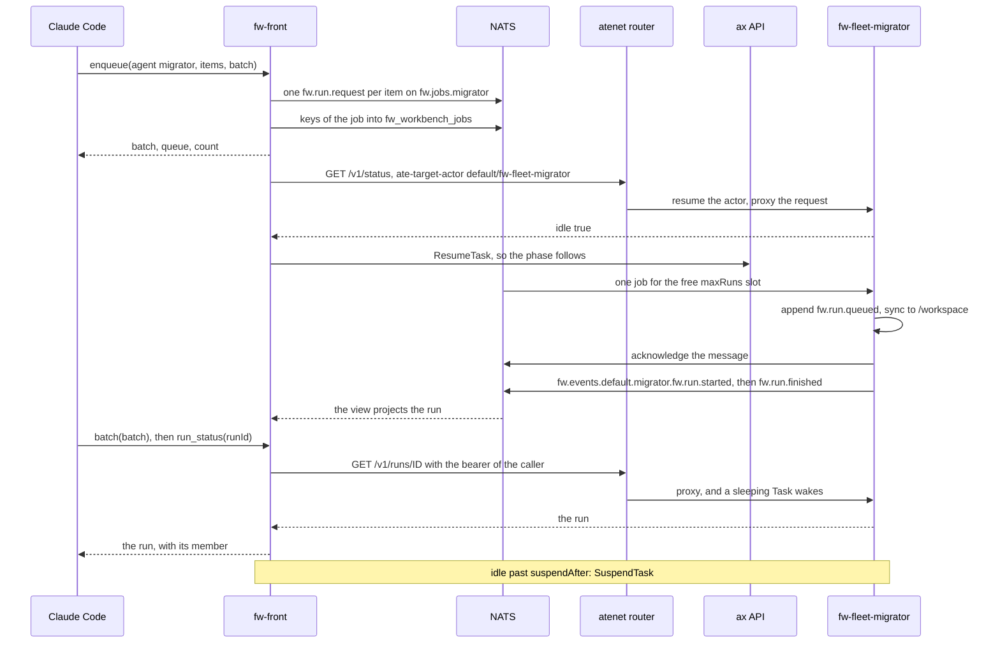

# The fleet

A fleet is a set of workers and one front. A worker is a kernel, the front is a window, and the platforms keep the state. This page explains what each side holds, how the front sees the workers, how work reaches a worker, and how a worker delegates.

The design is in [4. Fleet](../design/workbench-architecture.md#4-fleet) of the workbench architecture and in [3.2 Bounded fleet delegation under a person's identity](../design/product-direction.md#32-bounded-fleet-delegation-under-a-persons-identity) of the product direction. The steps to deploy one are in [A fleet](../deployment/fleet.md). The use from an MCP client is in [Use a fleet from Claude Code](../getting-started/from-claude-code.md).

## The worker and the front

A worker is a bare `fw` in one ax Task. It takes run requests from its intake queue, publishes the lifecycle events of its runs on the egress stream, and publishes nothing about itself. The front is `fw-workbench` outside the sandboxes, as a Deployment. It reads the Task list from the ax API and the state of every run from the egress stream. It projects both into one view and serves people through its native API, its MCP server, and its page. No member leads the others, and no election takes place.

| Who | Holds | Does not hold |
|---|---|---|
| A worker | its ledger on `/workspace`, its runs, its profiles from `fw.yaml`, the static token of the fleet | a grant of a person, a view of the other workers |
| The front | the view in memory, the grants of people, the job records, the overlays of its pools, the keys of its sources | a ledger of a worker, a run of a worker |
| The platforms | ax: the Tasks and their phases. NATS: the queues, the stream, and the buckets. Substrate: the volume of each Task. | the meaning of a run |

A fleet is not a set of replicas. Replicas of one agent share one ledger and serve the same runs. Each worker keeps its own ledger, and the front acts on a run through the Task that owns it. A worker needs five keys of the kernel: `bus.driver`, `bus.url`, `bus.egress`, `bus.intake`, and `tokens.url`. The front names its sources in the block `workbench.fleet`.

| Key | Variable | Meaning | Default |
|---|---|---|---|
| `workbench.fleet.atespaces` | `FW_WORKBENCH_FLEET_ATESPACES` | The atespaces whose Tasks are members, read from the ax API at `ax.server` | none |
| `workbench.fleet.egress` | `FW_WORKBENCH_FLEET_EGRESS` | The subject prefix of the egress stream, `bus.egress` on each worker | none |
| `workbench.fleet.intake` | `FW_WORKBENCH_FLEET_INTAKE` | The subject prefix of the intake queues | none |
| `workbench.fleet.interval` | `FW_WORKBENCH_FLEET_INTERVAL` | The time between two reads of the Task list | `30s` |
| `workbench.fleet.expire` | `FW_WORKBENCH_FLEET_EXPIRE` | The age after which the view forgets a finished run | `168h` |
| `workbench.fleet.suspendAfter` | `FW_WORKBENCH_FLEET_SUSPEND_AFTER` | How long a Task stays idle before the front suspends it, or `off` | `10m` with atespaces |
| `workbench.fleet.wakeOnQueue` | `FW_WORKBENCH_FLEET_WAKE_ON_QUEUE` | Whether the front wakes sleeping Tasks for the jobs in a queue | `on` with atespaces and intake |

```yaml
bus: { driver: nats, url: "nats://nats.agents.svc:4222" }
ax: { server: "ax-server.ax-system.svc.cluster.local:8080" }
workbench:
  fleet:
    atespaces: [default]
    egress: fw.events
    intake: fw.jobs
    suspendAfter: 10m
```

## The two sources of the view

The front reads two sources, and it never polls a Task for its state.

1. The ax API. At every `workbench.fleet.interval`, the front lists the Tasks of `workbench.fleet.atespaces`. Each Task is a member with the state of its phase. A running Task is `live`. A suspended or pending Task is `quiet`. Any other Task is `stopped`. A Task that leaves the list leaves the view.
2. The egress stream. The front subscribes to `workbench.fleet.egress`, which is `bus.egress` on each worker. A worker publishes each ledger event to `<prefix>.<atespace>.<agent>.<type>`, and the front projects every run with the projection of the kernel. The state, the title, the pending approval, the turns, and the usage of a run are those of the ledger of the worker. The usage comes from the totals that `fw.run.finished` and `fw.run.suspended` carry, so the stream needs no `fw.model.responded`. Each event names its node, so the front knows which Task holds the run. A `fw.run.child` event tells the view where a child of a run lives.

A read of a sleeping Task wakes it, so the front reads a Task through the router only while the Task is awake. When a Task becomes live, the front reads `GET /v1/runs` and `GET /v1/agents` of it with the static token. The runs that started before the front listened are then in the view, and the front knows which profiles the Task serves. While the view holds a run of a live Task as queued or running, the front reads its runs again once a minute. A suspend can cut the final events of a run, and this read repairs that case.

The suspend controller reads the status of an idle Task right before it suspends it. It reads a busy Task without events at most once per interval (below). A finished run leaves the view after `workbench.fleet.expire`.

## The name of a member

A member is named `<atespace>/<task>`, and its address is `ax:<atespace>/<task>`. That address is also the node name that a worker writes into every ledger event, the key `node` of its configuration. In the lab, the atespace `default` holds the Tasks `fw-fleet-alpha`, `fw-fleet-migrator`, and `fw-fleet-reviewer`. The migrator is therefore the member `default/fw-fleet-migrator` at the address `ax:default/fw-fleet-migrator`. A worker outside ax that publishes events is visible under its node name, without an address. It leaves the view after `workbench.fleet.expire` without an event.

## Reaching a run of a member

Run ids are unique across the fleet. A request can name a run that the front does not have but the view knows. The front then forwards the request to the Task that owns the run. This applies to the native routes under `/v1/runs/{id}`. It also applies to the MCP tools `run_status`, `run_events`, `run_file`, `approve`, `cancel`, `send`, `fork`, and `run_budget`. The front builds `run_result` and the transcript itself, from the run and the events that it reads from the owner.

The forwarded request goes to the atenet router at `ax.router` with the header `ate-target-actor: <atespace>/<task>`. The router is the only door into a Task. If the Task sleeps, the router wakes it first. The request carries the bearer credential of the caller. The owner authenticates the caller again, authorizes the action with its own rules, and records the real decider in its ledger. The front and the workers must trust the same issuer and audience, or share the static token. A 401 from the owner becomes a 403 for the caller, and an owner that does not answer gives a 502. The header `Fw-Fleet-Via` names the front, and a member never forwards such a request again. A caller with an X.509 client certificate, or over stdio, carries no bearer credential and acts only on the runs of the front. After every answer of a Task whose phase is not Running, the front calls `ResumeTask` on the ax API, so the phase follows the wake. `POST /v1/runs?member=<name>` and the argument `member` of the tool `run` start a run on a member.

## Jobs and batches

A job is many pieces of the same work, one run each, spread over the workers that run one profile. The MCP tool `enqueue` takes `agent`, `items`, and `batch`. It puts one `fw.run.request` message per item on the intake queue of the profile, `<workbench.fleet.intake>.<agent>`, for example `fw.jobs.migrator`. Each request names the caller as its principal, so the run on the worker acts as that person. Each carries the batch name in the metadata key `fw.batch`, which a child run inherits. The idempotency key of a request is the batch name and the position of the item. A job that is sent twice therefore starts each run once. One call takes at most 500 items, and a batch name has at most 128 characters. The call returns at once with the batch name, the queue, and the count. On a NATS bus, the front records the keys of the requests in the key-value bucket `fw_workbench_jobs`. Every replica of the front then counts the same job. After the publish, the front wakes the sleeping Tasks that serve the profile.

On the worker, `bus.intake` names the queue. The intake takes a message only for a free slot of `maxRuns`, which is 1 under ax. A Task therefore holds one job at a time, and the other Tasks of the queue take the other jobs. A run that waits for a person has no driver, so its slot is free. The handler acknowledges the message as soon as `fw.run.queued` of its run is in the ledger. The file ledger syncs that event to the disk before the append returns. The handler does not wait for the end of the run. From then on the ledger holds the job. A run that a suspend or a crash interrupts resumes from the ledger at the next start of the same Task. No other Task starts a second run of it.

`bus.intakeRetries` is the number of times that the kernel puts a failed job on its queue again. The default is 0, because each retry spends model tokens. A retry is a new message with the idempotency key `<failed run>.retry` and the metadata `fw.intake.attempt` and `fw.intake.retryOf`. The subject `<intake>.dead`, for example `fw.jobs.migrator.dead`, receives a record for every job whose run failed after its last attempt. It also receives a record for every request that cannot start. The record is the event `fw.intake.dead` with the queue, the request, the run, the outcome, `failed` or `rejected`, the error, and the attempts. `bus.deadLetter: true` is the default. The kernel annotates the run with `fw.intake.queue` and `fw.intake.outcome`: `retried`, `dead-lettered`, or `dropped`. To redrive a job by hand, read the record and call `enqueue` again. An event source with `redrive` does this itself (see [Event sources](#event-sources)).

The tool `batch` tells how a job goes: `jobs`, the requests that the caller sent, and `queued`, the jobs that no Task took yet. It also lists the runs by state and the members that hold them. It names the runs that wait for the person and the runs that failed, with their errors. It sums the usage of the runs, and the sum reads as partial while a run is missing or works. `runs_list` and `GET /v1/fleet/runs` take `batch` as a filter. The details are in [4.9 Jobs](../design/workbench-architecture.md#49-jobs) and [9.3 Intake](../design/kernel-architecture.md#93-intake).

The workbench architecture says that the NATS intake takes four messages at a time by default. The driver sets `concurrency` to `maxRuns`, which is 1 under ax, so the code wins.

## The egress stream and the cursors

`bus.egress` names the subject prefix, and `bus.egressTypes` limits the types. With the file ledger, the ledger is the queue of the egress. One goroutine reads the events after the cursor of each run, publishes them in order, and saves the cursor. An append therefore never waits for the bus. The cursors are files under `<ledger>/.egress/`, one for each route and run. A pass publishes at most 128 events of one run before it goes on to the next run. A pass over every run comes at the boot and then once a minute. If the bus refuses, the goroutine tries again with a pause that doubles up to 30 seconds.

The delivery is at least once. The events behind a cursor reach the disk before the cursor does. A crash can therefore repeat an event under the same id, but it never skips one. A consumer drops an id that it has seen and applies the events of a run by their sequence number. The view does this, and it never lets an older event undo the state of a later one. A memory ledger keeps a queue of 10,000 events in memory instead, and a crash loses it. A suspend kills `fw` without `SIGTERM`. The final events of a run can therefore wait on the disk until the next boot of the Task. The front covers that gap with its read of a live Task once a minute. The rules are in [9.4 Egress](../design/kernel-architecture.md#94-egress).

## Idle and the suspend controller

`GET /v1/status` of a worker gives the state of the agent at a glance. When no run is queued or running, `idle` is true: every run waits for input, is suspended, or is finished. `idleSince` is the newest update of a run. When no run worked yet, it is the start of the process. While a run works, it is absent. The body also carries `runs.active`, `runs.inputRequired`, and the oldest `pendingApproval`.

While a child in another Task works, the parent is not idle. The controller therefore does not put the parent to sleep while its children spend.

At every interval, the controller looks at every Task whose phase is Running and whose newest run update is older than `workbench.fleet.suspendAfter`. A Task with no queued or running run in the view is idle. For each idle Task, the front reads `GET /v1/status` once through the router, which wakes nobody because the Task runs. If the body says `idle` and the idle time is at least the grace period, the front calls `SuspendTask` on the ax API. The body of the Task decides, so a view that missed an event suspends nobody who works. A suspended Task costs nothing, and the log of the front names every Task that it suspends and wakes.

A storage failure, such as a full `/workspace`, blocks the kernel of a Task. The kernel writes nothing, keeps its open runs in their last state, and sends no event, so the view shows those runs as running. The controller therefore also reads the status of a busy Task at most once per interval. A busy Task has a queued or running run in the view. After a storage failure, the body of the status says `blocked: true` with `blockedReason`, and `idle: true` since the failure.

If the body says `blocked`, the front suspends the Task at once and marks the member with the reason. A busy Task that is not blocked stays awake, because its runs can work slowly. A run that a read of the front shows with the field `blocked` does not count as working.

The mark shows in the field `blockedReason` of the member in `GET /v1/fleet`, and the MCP tool `fleet` says `blocked by a storage failure` on the line of the member. The worker removes the secrets from the reason, and the front removes its own secrets too and cuts the reason to 2 KiB. The gauge `fw_fleet_members_blocked` counts the marked members (see [Observability](../deployment/observability.md#the-series-of-the-front)). Only a replica of the front that read the status marks the member, so take the maximum over the replicas.

The front does not resume the Task itself. The next request through the router restarts it: a wake for a job, an approval, a message, or a run. The fresh process rebuilds from its ledger, and the next event of the member clears the mark. If the storage is still full, the fresh process can block again, and the controller suspends it again after the grace period. Repair the storage of the Task before you wake it. See [4.12 The suspend controller](../design/workbench-architecture.md#412-the-suspend-controller).

The router wakes a suspended Task on the next request through the front: an approval, a message, a follow-up, or a run. The ax API does not learn of such a wake. The front therefore calls `ResumeTask` after every answer of a Task whose phase is not Running. A Task that sleeps reads no queue, so a job needs a wake of its own:

- After `enqueue`, the front wakes every suspended Task that serves the profile, with one read of `GET /v1/status` through the router. The log names the cause `enqueue`. If no sleeping Task is known to serve the profile, the front wakes the sleeping Tasks whose profiles it does not know yet.
- With `workbench.fleet.wakeOnQueue`, on by default with atespaces and an intake prefix, the front reads the queues at every interval. It reads the durable consumer of each queue on the JetStream stream of `bus.options.stream`, `FW` by default. It takes two numbers: `pending`, the jobs that no worker took yet, and `ackPending`, the jobs that a worker took and did not acknowledge yet. When jobs wait and no awake Task that serves the profile has room, the front wakes the sleeping Tasks with the cause `queue`. When no job left the queue for three intervals, it wakes them too. A Task that such a wake reached stays out of the next wakes for four intervals. A read of the queues sends no request to a Task.

The controller and the wakes are in [4.12 The suspend controller](../design/workbench-architecture.md#412-the-suspend-controller) and [4.13 Queue depth](../design/workbench-architecture.md#413-queue-depth). The series `fw_fleet_queue_pending`, `fw_fleet_queue_ack_pending`, and `fw_fleet_dead_letters_total` show the queues from the front (see [Observability](../deployment/observability.md)).

## One enqueued job

The diagram shows one job from Claude Code to a sleeping worker and back. The worker is the lab Task `fw-fleet-migrator`, which takes the queue `fw.jobs.migrator`.



## Delegation into child Tasks

An agent creates other agents with the tool `spawn_task`. Without a spawner, the child runs in the same process. With `spawn.driver: ax`, the spawner runs each child in a child Task of its own, so the child has a workspace of its own. The spawner creates the Task through the ax API at `ax.server`. The child Task gets the image, the command, the resources, the environment, and the workspaces of the parent Task. It gets no goals and no debug services. The child inherits `spec.egress`, so it reaches what its parent reaches and nothing more. ax creates the egress policy of the child before it first runs. The child gets `FW_PARENT_RUN`, `FW_PARENT_MEMBER` with the name of the parent Task as `ax:<atespace>/<task>`, `FW_SPAWN_MAX_DEPTH`, and `FW_SPAWN_MAX_DESCENDANTS`. An exhausted child gets `FW_SPAWN_DISABLED=true`. The name of the child Task has three parts. They are the name of the parent, cut to a DNS label, a hyphen, and the id of the child run in lower case.

ax creates every Task suspended. The spawner therefore resumes the child Task, waits until it runs, and starts the child run through the router at `ax.router`. The start carries the static token of the fleet, the person of the parent, and the id that the parent chose. Its idempotency key is `spawn:<parent>:<atespace>/<task>`. The parent records `fw.run.child` before anything exists, and again once the child started, so a restart finds every Task that the spawner created. From then on, the parent follows the child through the router. It reads the child once a second while a tool waits, and in the background every five seconds while the child works. A child that waits for a person is not read, so a sleeping child stays asleep. A child Task that never gets its run is deleted. A child Task that finished its run stays for its ledger, and the suspend controller puts it to sleep. The parent Task needs the ax server and the router in its egress policy.

Every delegated run obeys four invariants:

1. Monotonic attenuation. A child uses only tools that its own profile and every ancestor allow. It carries the rules of every ancestor, and the stricter verdict wins. Its budget is the budget of the parent, capped. Its deadline is the working time that the parent has left. `maxTokens`, `maxCostUSD`, and `maxToolCalls` are lowered to what the tightest tree of the lineage has left. The usage of the child counts in the tree of its parent and of every ancestor.
2. Acting as the person without exposing grants. The child acts as the person of the parent, and it gets the tokens of that person from the broker of the front. No refresh token enters a sandbox (see [Identity](../concepts/identity.md)).
3. Single point of supervision. When a child needs an approval or asks a question, `spawn_task` relays it to the caller of the parent. It arrives as a question on the parent run, every surface shows it, and the answer goes to the child.
4. Hard guardrails at the token boundary. Every worker enforces the budget limits, the per-tool byte and time bounds, and the loop guard. It redacts secrets before an event reaches the ledger or the bus (see [Safeguards](../concepts/safeguards.md)).

Four limits bound a tree. `spawn.maxDepth`, 3 by default, bounds how deep the tree goes. `spawn.maxChildren`, 16 by default, bounds how many children one run starts in its life. `spawn.maxDescendants`, 32 by default, bounds how many runs one tree holds under its root, in every process together. A child in another Task reserves a share of that room before its Task exists, and the share travels in the metadata key `fw.maxDescendants`. `spawn.maxRunning`, 8 by default, bounds how many child runs of one process work at the same time. Past any bound, `spawn_task` returns an error that names it, and the model goes on without the child. A remote spawn with a custom Go policy or `policy.external` is refused. A child Task that a pool worker creates belongs to no pool, because its name is `<parent>-<run id>`. The full rules are in [11.9 Child runs and child tasks](../design/kernel-architecture.md#119-child-runs-and-child-tasks).

## Fork into a child Task

The MCP tool `fork` branches a run: the branch keeps the events of the run up to `seq` and goes on with `input`, with `model`, or the same way again. With `spawn`, the branch runs in a Task of its own, with a workspace of its own. Two branches therefore never see each other's files. The spawner does this in two steps. `Place` creates a child Task, as a spawn does, and returns its member name at once. The kernel records the branch as a queued run with `Member` set and answers the call. The start goes on in the background. `Branch` waits until the child Task runs and sends the kept events to `POST /v1/runs/fork` of the child, under the id of the request. A Task that does not run, or that does not take the branch, is deleted.

Until the events of the child arrive, the view shows the branch under the source member as a queued run. A request for it goes to the source Task, which answers for it. The lab needs this: agentgateway lets a request wait ten seconds, and a Task takes longer to boot. The fork call therefore answers with the queued stub, and the client follows it with `run_status`. A branch is a run of its own. It shares no budget and no count with the tree of its source. It is no job, so it gets no retry and no dead letter. Branches are in [4.7 Branches](../design/kernel-architecture.md#47-branches).

## Pools

A pool keeps a number of Tasks that run one profile. The block `workbench.pools` lists the pools, and at every interval the front makes the Tasks of each pool match the configuration.

| Key | Meaning | Default |
|---|---|---|
| `name` | The name of the pool. Its Tasks are `<name>-<index>`, and their Workspaces are `<name>-<index>-ws`. | required |
| `replicas` | The number of Tasks. With `0`, the front deletes every Task of the pool once it is idle. | required |
| `image` | The worker image by digest, `<image>@sha256:<64 hex digits>` | required |
| `agent` | The profile whose queue the workers take | the only profile of `fw.agents` |
| `generation` | A number that orders the configurations of the pool. Raise it with every change. | `0`, no order |
| `env`, `egress`, `resources`, `files` | The variables, the `spec.egress`, the resources, and the extra files of each Task | `egress` is required |
| `fw` | The `fw.yaml` of each worker | required |

The front writes `fw` to `.fw/fw.yaml` in the Workspace of each Task. It adds `bus.intake`, `bus.egress`, `bus.egressTypes`, the bus of the front, `auth.mode: token`, `ax.server`, `ax.router`, and `bus.options.concurrency: 1`. It marks each Task with the variables `FW_POOL`, `FW_POOL_SPEC`, the hash of the configuration, and `FW_POOL_GENERATION` with `FW_POOL_BASE`. It copies the static token of the fleet into each Task. A Task belongs to the pool only with the name `<name>-<index>` and `FW_POOL` set to the name of the pool. The front never touches another Task.

A pass has six steps:

1. It sends a pending delete again.
2. It puts aside a Task that failed after it ran.
3. It deletes the Tasks above `replicas`, the idle ones first.
4. It resumes a Task that never ran.
5. It creates the missing Tasks.
6. It replaces the Tasks of an older configuration, one at a time.

When its hash, its generation, or a value of a variable of the front differs, a Task is older. The front replaces or deletes a Task only once it is idle. It asks `GET /v1/status` of the Task for `runs.active`, asks `GET /v1/runs/{id}` for each run that the view holds, and then asks the view once more. A Task that does not answer stays, and a person decides. The front never deletes a Task with an active run, and a run that waits for input is active.

No replica of the front leads, so the generation gives the order. A replica that sees a Task of a higher generation changes nothing in the pool. Two configurations with one generation are a conflict, and neither replica changes the pool. Before it changes a Task, a replica records its generation in the marker Workspace `<name>-generation`.

The front owns the profiles of its pools. On a NATS bus, the overlay of a pool lives in the key-value bucket `<stream>_POOL_<pool>`, with one entry per profile and per allow rule. Every replica therefore reads one truth. `agent_put`, `agent_delete`, and the builder write to the overlay of the pool that runs the profile. `agents_list` and `agent_get` show what the workers run. Always allow on the approval card, and `approve` with `rule`, add an allow rule to the policy of the pool. A change needs the owner role on the profile, and a new profile needs the creator role, decided with the access configuration of the front. A change of the overlay changes the hash, so the pool replaces each Task once it is idle. `fw-workbench pools render` prints the Tasks that the front applies, with a placeholder for each secret. The rules are in [14. Pools](../design/workbench-architecture.md#14-pools).

## Event sources

An event source turns the events of an outside system into runs, with no person in between. Each entry of `workbench.sources` names an `agent` and the templates `input`, `title`, `metadata`, and `key`. A webhook source takes events on `POST /v1/sources/<name>`, with `auth.mode` set to `bearer`, `hmac`, or `none`. A poll source reads `poll.url` every `poll.every`, 1 minute by default. For each event, the source renders a run request. It puts the request on the intake queue of the profile through the same publish as `enqueue`. A source therefore wakes the sleeping Tasks in the same way. The run acts as `runAs`, `source:<name>` of the kind `workload` by default. Its metadata carries `fw.batch` with the name of the source, `workbench.source`, and `workbench.sourceKey`.

A source starts one run per event, also with two replicas of the front. The keys live in the NATS key-value bucket `<stream>_SOURCE_<name>`, with a TTL of `dedupFor`, 7 days by default. A source claims the key as `pending`, publishes the request, and marks the claim `done`. The server decides, so of two replicas that claim one key, exactly one gets it. A `pending` claim older than two minutes goes to the next delivery. The idempotency key of the request is `<source>/<key>`, so a worker that gets the same request twice returns the first run. A claim is done once the request is on the queue, not once the run ends well. With `redrive`, a job that reached the dead letter can run again. Every replica reads `<queue>.dead` through one shared consumer and marks the claim `failed`. After `redrive.cooldown`, 5 minutes by default, the next delivery runs the event again, with a new generation in `workbench.sourceGeneration`. `redrive.maxAttempts`, 3 by default, counts the first run too. The details are in [13. Event sources](../design/workbench-architecture.md#13-event-sources).

## Titles

A run has a title, such as "Fix checkout retries", so a list names the work and not only the worker. The kernel gives a run the title of its request, or else the first sentence of its input, and makes no call. The package `titles` asks a model for a title the first time that the workbench shows a run that has none. It records the title on the run as the metadata `fw.title`, with the usage of the call. A title has at most 64 characters. `workbench.titles: input`, or `FW_WORKBENCH_TITLES=input`, saves the call. A run of another member, a child run, and a run whose request set a title get no call (see [9. Titles](../design/workbench-architecture.md#9-titles)).

## Teams

A team is a group of people and agents that work together. The teams of a person are the groups of the principal that match the patterns of `workbench.teams`, or `FW_WORKBENCH_TEAMS`. An empty list makes every group a team. The teams of an agent are the groups that its access block names as `group:<name>`. A run keeps the teams of the person who started it in the metadata key `workbench.teams`. A team groups the view and grants no access. The runs lists take `by`, which is `me`, `team`, or `others`, and `whoami` returns the teams of the caller (see [8. Teams](../design/workbench-architecture.md#8-teams)).

## Sources

- `featherweight-workbench/README.md`
- `featherweight-workbench/docs/ARCHITECTURE.md`
- `featherweight-workbench/docs/PRODUCT_DIRECTION.md`
- `featherweight-workbench/fleet/config.go`
- `featherweight-workbench/fleet/types.go`
- `featherweight-workbench/fleet/enqueue.go`
- `featherweight-workbench/fleet/jobs.go`
- `featherweight-workbench/fleet/forward.go`
- `featherweight-workbench/fleet/relay.go`
- `featherweight-workbench/fleet/read.go`
- `featherweight-workbench/fleet/platform.go`
- `featherweight-workbench/fleet/suspend.go`
- `featherweight-workbench/fleet/view.go`
- `featherweight-workbench/fleet/metrics.go`
- `featherweight-workbench/dashboard/fleet.go`
- `featherweight-workbench/fleet/suspend_test.go`
- `featherweight-workbench/fleet/queues.go`
- `featherweight-workbench/fleet/nats.go`
- `featherweight-workbench/pools/config.go`
- `featherweight-workbench/pools/render.go`
- `featherweight-workbench/pools/reconcile.go`
- `featherweight-workbench/sources/config.go`
- `featherweight-workbench/sources/store.go`
- `featherweight-workbench/sources/nats.go`
- `featherweight-workbench/sources/webhook.go`
- `featherweight-workbench/sources/redrive.go`
- `featherweight-workbench/sources/sources.go`
- `featherweight-workbench/teams/teams.go`
- `featherweight-workbench/titles/titles.go`
- `featherweight-workbench/surface/mcp/batch.go`
- `featherweight-workbench/surface/mcp/tools.go`
- `featherweight-workbench/surface/web/web.go`
- `featherweight-kernel/README.md`
- `featherweight-kernel/docs/ARCHITECTURE.md`
- `featherweight-kernel/examples/fw.yaml`
- `featherweight-kernel/fw/config.go`
- `featherweight-kernel/fw/kernel.go`
- `featherweight-kernel/fw/run.go`
- `featherweight-kernel/fw/intake.go`
- `featherweight-kernel/fw/busio.go`
- `featherweight-kernel/fw/spawn.go`
- `featherweight-kernel/fw/fork.go`
- `featherweight-kernel/fw/turn.go`
- `featherweight-kernel/ax/config.go`
- `featherweight-kernel/ax/spawn.go`
- `featherweight-kernel/bus/nats/nats.go`
- `featherweight-kernel/tools/builtin/child.go`
- `featherweight-kernel/surface/view/status.go`
- `featherweight-lab/e2e/README.md`
- `featherweight-lab/e2e/fleet/fw.yaml`
- `featherweight-lab/e2e/fleet/ax/run.sh`
- `featherweight-lab/e2e/fleet/fork.py`
