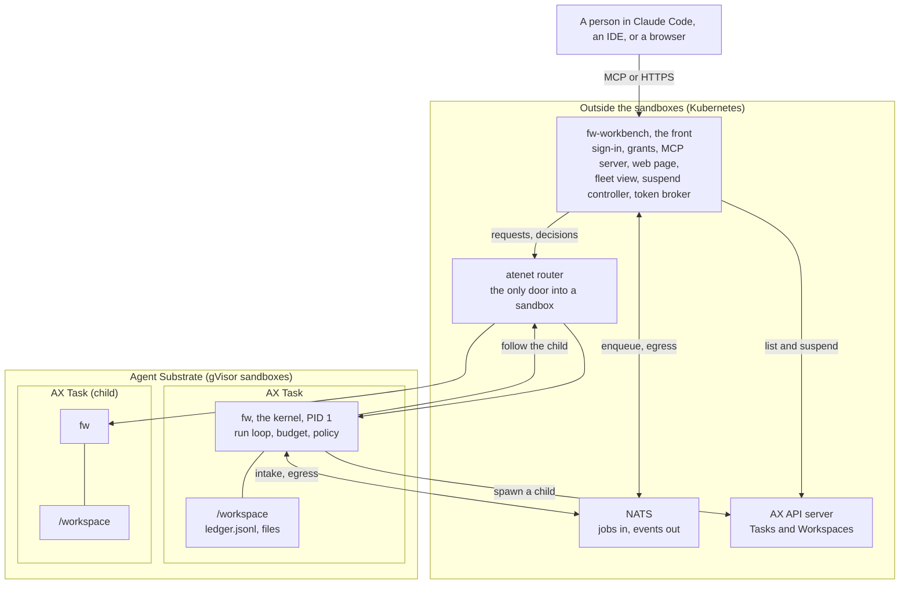

# The four layers

Featherweight is four layers that stack. Agent Substrate makes sealed boxes. Google AX hands the boxes out and keeps the list. The kernel is the one worker who lives inside a box. The workbench is the front desk outside every box, where people come in. The lab is the test rig and the cluster setup, not a layer of the product.

## Agent Substrate

Agent Substrate runs on the cluster and makes sandboxes. A sandbox is a sealed container that runs under gVisor, a user-space Linux kernel that keeps the host safe from whatever runs inside. Substrate calls a sandbox an actor. Each actor has one folder, `/workspace`, that Substrate can freeze and thaw. A suspend takes a snapshot of `/workspace` and frees the CPU and the memory. A resume restores that snapshot into a fresh container.

Substrate also runs the atenet router, the only door into an actor. A request names its actor in the header `ate-target-actor`. If the actor sleeps, the router wakes it first. And Substrate holds one egress policy per actor: a list of hosts that the actor can talk to. The egress gateway blocks everything else. A policy can also inject a credential into an outbound request, so a key never has to enter the sandbox.

## Google AX

AX sits on top of Substrate and makes it feel like Kubernetes. You write a YAML file with a Task, which names the image and the environment variables, and a Workspace, which names the files and git repositories to put in `/workspace`. Then `ax apply` creates them. The commands `ax suspend`, `ax resume`, and `ax ssh` do what their names say.

AX treats whatever runs inside the Task as a black box. It does not know what a model turn is, whether the process works or waits, or when it is safe to suspend. It creates every Task suspended until something resumes it. The lab runs a patched AX that adds `spec.egress` to the Task, so the Task itself declares the hosts it can reach, and a child Task inherits that list. See [Platform gaps and patches](../operations/platform-gaps.md).

## The kernel

The kernel, the binary `fw`, is the program inside one Task. It runs as PID 1, the first process, so it is the whole container. It is one agent and nothing more. It loads a profile, which is the system prompt, the tools, the model, the budget, and the policy. Then it runs the loop: ask the model, run the tools that the model asked for, repeat.

The kernel writes every event of that loop to the ledger, an append-only log file in `/workspace`. The ledger survives a suspend because `/workspace` does. So the agent can be frozen in the middle of a task and continue later from the exact event where it stopped. The kernel also knows when it has nothing to do and says so on `GET /v1/status`. It creates a child Task through the AX API when it delegates. It asks the front for a short-lived token when a tool must act as the person who started the run.

Work reaches the kernel in two ways: a direct request through the router, or a job from a NATS queue. The kernel takes jobs from an intake queue and reports its events on an egress stream. The same binary also runs as a plain process on a laptop, as a container, or as a Go library. See [The run lifecycle](run-lifecycle.md), [The ledger](ledger.md), and [Safeguards](safeguards.md).

## The workbench

The workbench, the binary `fw-workbench`, runs outside every box as a normal Kubernetes Deployment. The fleet design calls it the front. It signs people in with OpenID Connect. It keeps their OAuth grants in an encrypted store, so a refresh token never enters a sandbox. It serves the MCP server at `/mcp` and the web page at `/ui`. The tools that Claude Code sees, such as `run`, `enqueue`, `batch`, `approve`, and `run_result`, are the workbench.

The workbench reads the list of Tasks from the AX API and the events from the bus to show the fleet. It puts jobs on the queues. It sends an interactive request to a Task through the router. It suspends a Task that reports idle, and it wakes a sleeping Task when a job arrives for it. It mints the short-lived tokens that the workers ask for. It keeps pools, a fixed number of Tasks that run one profile. It holds almost no state of its own: AX holds the Tasks, Substrate holds `/workspace`, the ledger inside each Task holds the run, and Prometheus and Grafana hold the metrics. See [The fleet](fleet.md) and [Identity](identity.md).

The same binary also runs on a laptop with every verb of `fw`, the page, and the MCP server over standard input and output. See [Run the workbench on your machine](../getting-started/workbench-local.md).

## The lab

The lab repository holds no product code. It holds the end-to-end tests that drive a running `fw` or `fw-workbench` over the wire with a real model, the installer of one homelab k3s cluster with Substrate and AX, the fleet deployment of that cluster, and the ticket soak. See [The homelab cluster](../operations/homelab.md) and [Testing](../operations/testing.md).

## One job through all four layers

A person tells Claude Code to migrate twelve Puppet modules.

1. Claude Code calls the `enqueue` tool on the front. The front puts twelve jobs on the queue of the migrator profile, with the identity of the person attached to each one.
2. The migrator Task is asleep. The front asks AX to resume it. Substrate restores `/workspace` into a fresh container.
3. The kernel starts as PID 1, rebuilds its state from the ledger, and takes one job from the queue. It runs the loop against the model through the model proxy.
4. The kernel needs to push a branch to GitHub. The tool acts as the person, so the kernel asks the front for a short-lived token. The refresh token stays in the front.
5. The kernel hits a policy rule that needs an approval. It writes the approval request to the ledger and reports idle. The front suspends the Task. The Task costs nothing while it waits.
6. The person approves from Claude Code. The front sends the decision through the router. The router wakes the Task. The kernel reads the ledger and continues the run from the approval.
7. The run ends. The result goes out on the egress stream. The person reads it with `run_result`. The front suspends the Task again after the idle timeout.

## Why the kernel exists beside AX

AX gives you a box and a freezer, and no view of what happens inside the box. Put a general agent framework inside the Task instead, and three things go wrong. The framework keeps the conversation in memory, so a suspend loses the thread. Nothing reports idle, so nothing knows when a suspend is safe. The whole tree of child agents runs on one service credential inside the sandbox. The kernel fixes those three things: a ledger that survives the freeze, an idle signal that makes the freeze automatic, and a token broker with budgets and policy, so that every box acts as a person within bounds. The [product direction](../design/product-direction.md#2-why-this-layer-exists) states the argument in full.

The value shows up when runs are long, when they wait on approvals or sign-ins, when many of them sleep most of the time, and when they fan out into trees. For a short batch job that never waits on a person, a plain container with any agent loop does about as well.

## Sources

- featherweight-kernel/README.md
- featherweight-kernel/docs/KERNEL_MAP.md
- featherweight-workbench/README.md
- featherweight-workbench/docs/PRODUCT_DIRECTION.md
- featherweight-lab/e2e/README.md
- featherweight-lab/e2e/fleet/ax/hello.yaml
- ax/README.md
