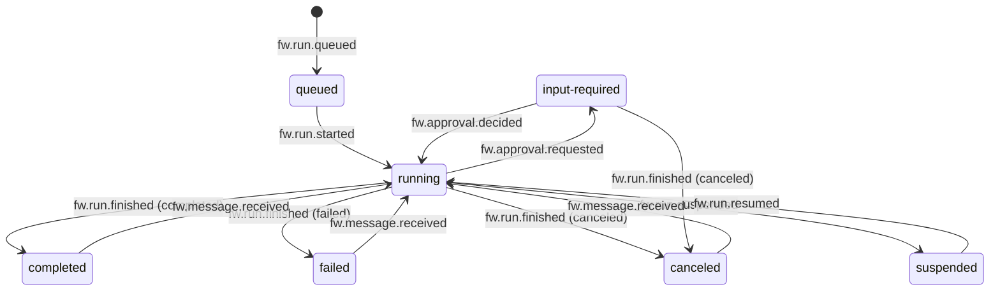

# The run lifecycle

A run is one conversation between one agent profile and one model, with one budget and one ledger. The ledger is the append-only log of the run. Every state on this page is a projection of that log. One loop therefore starts a run, continues it after a decision, and resumes it after a restart. This page follows a run from its start to its end.

## The states

The type `RunState` in `fw/run.go` names seven states. The status projection in `fw/projection.go` (`Run.Apply`) computes the state of a run from its events.

| State | Meaning | Set by |
|---|---|---|
| `queued` | The run has its `fw.run.queued` event, and no driver worked on it yet | `fw.run.queued` |
| `running` | A driver works on the run | `fw.run.started`, `fw.run.resumed`, `fw.turn.started`, `fw.message.received`, `fw.approval.decided` |
| `input-required` | The run waits for a person: an approval, an answer, or a connection | `fw.approval.requested` |
| `completed` | The model ended its turn with an answer | `fw.run.finished` with the outcome `completed` |
| `failed` | An error, a limit, a refusal, or a loop ended the run | `fw.run.finished` with the outcome `failed` |
| `canceled` | A person or a parent run canceled the run | `fw.run.finished` with the outcome `canceled` |
| `suspended` | The process stopped on `SIGTERM` while the run worked | `fw.run.suspended` |

`completed`, `failed`, and `canceled` are terminal (`RunState.Terminal`). A terminal run is not dead: a follow-up message reopens it.

## How a run starts

Every start appends `fw.run.queued`. The event holds the input, the agent name, the instructions, the inline profile, the budget, the metadata, the origin, the principal, and the resolved profile. A resume and a replay therefore see the same request. Then the kernel launches a driver, one goroutine that owns the run (`launchLocked` in `fw/kernel.go`).

A request with an idempotency key that the process saw before returns the first run. A second start with the same key that arrives while the first start is in progress waits for the durable acceptance of the first start. Then it shares the result, the run or the error. If that waiter gives up, the first start goes on.

| Entry | What starts the run | Origin |
|---|---|---|
| Native API | `POST /v1/runs` with a JSON body: `input`, and as options `agent`, `instructions`, `profile`, `budget`, `metadata`, `outcome`, and `wait` | `http` |
| A2A | A message to the A2A surface at `/a2a` (REST) or `/a2a/jsonrpc`. A message to an open task is a follow-up. | `a2a` |
| Bus intake | A run request on the queue `bus.intake`. The intake takes a job only for a free run slot. | `bus` |
| Command line | `fw run "<input>"`, which waits for the end and prints the output | `cli` |
| A tool | `spawn_task` in a parent run, which starts a child run | `tool` |
| MCP | The tool `run` of the workbench | `mcp` |

When `fw.run.queued` of a job is in the ledger, the bus intake acknowledges the job. It records the queue in the metadata key `fw.intake.queue`. If the run of a job fails, the kernel puts the job on the queue again, up to `bus.intakeRetries` times. After the last attempt, it sends a record to the subject `<intake>.dead`.

`fw run` takes the flags `--agent`, `--json`, and `--no-approve`. The profile flags are `--system`, `--instructions` (or `-i`), `--tools`, `--skills`, `--model`, `--effort`, and `--time-zone`. The budget flags are `--max-turns`, `--deadline`, and `--max-tool-calls`. The profile flags build an inline profile for this one run (see [Profiles, tools, and skills](../concepts/profiles-and-tools.md)). The command reference is [fw commands](../reference/fw-commands.md).

## Admission

Admission bounds the root runs that one process takes on (`fw/lifecycle.go`). The kernel reserves a place for a run before it appends the event that starts its work. `maxRuns`, or `FW_MAX_RUNS`, bounds the root runs that work at the same time: 16 by default, or 1 under ax. `maxQueuedRuns`, or `FW_MAX_QUEUED_RUNS`, bounds the root runs that the process admits beyond that and that wait for a working slot. Zero takes the default of 64.

A process therefore admits at most `maxRuns + maxQueuedRuns` root drivers for new work. A start, a branch, a follow-up, and a decision that starts a driver each reserve a place first. When no place is free, the kernel returns `fw.ErrSaturated` with a `fw.SaturationError` that names both limits. The native API answers 429 with `Retry-After: 5`. Retry with the same idempotency key. The A2A surface maps the same error to an internal error, which a client does not retry (`mapErr` in `surface/a2a/handler.go`). The bus intake returns the job to the queue for another delivery. A decision and a follow-up on an accepted run take a place from the same pool as new starts. An approval can therefore get a 429 while the process is full. A start that the process already accepted returns its run without another admission.

These rules decide who holds a place:

- A follow-up reserves its place before it stores its attachments or records a budget change. A refused follow-up therefore changes nothing of the run. If a driver that is already active takes the message, the place goes back.
- A branch that waits for a decision holds no place until the decision starts its driver.
- A child run takes no root place. The `spawn` limits and the limits of its tree bound it. A parent that waits for its children therefore never takes the places that they need.
- If a change of the configuration lowered the limits, the kernel still resumes at boot the work that the ledger already accepted.

The limits bound admission, not the history: finished and idle runs stay readable. See [section 5.6](../design/kernel-architecture.md#56-process-duties).

## The turn loop

A turn is one model call and the tool calls that it requests. The driver runs `drive` in `fw/turn.go`. At each step it reads the cursor of the run (`executionCursor` in `fw/cursor.go`) and does the next action. The cursor reads the log once and then takes up only the events after its last step. The cursor says whether the run started, whether a turn is open, what the latest response was, and which tool calls still need a result. Because the next action comes from the log alone, the same loop serves a new run, a follow-up, a decision, and a restart.

The steps are these:

1. `stepStart` appends `fw.run.started` with the model, the tool names, the brief, the context, and the time zone of the run. The brief is the text that tools add to the system prompt. The context is the data that tools add to the first user message, such as the memory index.
2. `stepModel` checks the budget. If the context is too large, it compacts the context. If a time note or a budget note is due, it adds the note. Then it appends `fw.turn.started` and `fw.model.requested`, calls the model, and appends `fw.model.responded`.
3. `stepResponse` acts on the stop reason of the response.
4. `stepTools` runs the loop guard, decides each tool call with the policy, and runs the allowed calls. It appends one `fw.tool.requested` and one `fw.tool.responded` per call. Consecutive parallel-safe calls run at the same time. Then it closes the turn with `fw.turn.finished`.
5. `endTurn` appends `fw.run.finished` with the text of the response as the output, unless a message arrived that the model has not seen. Then the next step starts a new turn.

| Stop reason | What the kernel does |
|---|---|
| `end_turn` | Closes the turn and finishes the run as `completed` |
| `tool_use` | Runs the tool calls, then calls the model again with the results |
| `max_tokens` | Appends `fw.error` and sends the message `Continue.` once. A second `max_tokens` in a row fails the run. |
| `refusal` | Finishes the run as `failed` with the refusal detail |
| `pause_turn` | Closes the turn and calls the model again at once |

A stream that the network cuts has no answer. The kernel appends `fw.error` with `retryable` true, waits half a second, and sends the same request once more in the same turn. A second cut fails the run. A suspend of a Task cuts the network before it freezes the process. If the process survives the suspend, this retry carries the run over it.

## Waiting for a person

Three things make a run wait. Each one is a `fw.approval.requested` event, so it survives a restart and a suspend. The design document calls this [section 5.3](../design/kernel-architecture.md#53-approvals).

An approval. The policy answers `ask` for a tool call, for example `bash` under the default rules. `stepTools` appends `fw.approval.requested` with the tool, the call id, the input, and the reason, and returns. The run is `input-required`, and the driver exits (`idleExit`), so no goroutine waits.

A decision arrives through `POST /v1/runs/{id}/approvals/{approval}`, through the tool `approve` of the workbench, or on the terminal of `fw run`. `Decide` appends `fw.approval.decided` and launches a driver again. The driver finds the decision in the log and runs the call, or gives the model an error result that names the denial. Before an allowed call runs, the kernel checks the rules of the profile and of every ancestor again. A deny that a person added while the call waited wins.

A question. The tool `ask_user` asks the caller through the same event, with a form schema in the field `schema`. Without a schema, the answer is free text under the key `answer`. The tool waits on a channel (`waitDecision`) while the process lives. After a restart, `ask_user` builds its result from the recorded question and its answer (`fw.Continuer`), so the question is not asked twice.

A connect request. A tool that acts for the person who started the run, such as an MCP server with `auth.oauth.grant: user`, needs a grant from that person. The kernel appends `fw.approval.requested` with the field `connect`, and the run waits until the person connects the service or skips it. A skip gives the model an error result. A call that waited for a connection never reached the service, so after a restart it runs again. See [Identity](../concepts/identity.md) and the workbench architecture, [section 11](../design/workbench-architecture.md#11-connections).

A child run that waits sends its question to its parent, so the parent is the one place to watch (`tools/builtin/child.go`).

## Idle, suspend, and wake

`GET /v1/status` on the native API tells a control plane whether the Task has work (`view.StatusOf` in `surface/view/status.go`). When no run is `queued` or `running`, `idle` is true. Every run then waits for input, is suspended, or finished, and a process without runs is idle. `idleSince` is the newest update of a run, or the start of the process. The process is also not idle in three cases. A child in another process is still starting (`Agent.Starting`). The process follows a child that works (`Agent.Following`). A package holds the process (`Agent.Hold`), for example during the install of an environment.

The front of the workbench reads the lifecycle events of every Task on `bus.egress`. Its suspend controller (`fleet/suspend.go`) looks at every running Task at each interval. A Task is a candidate under two conditions. The view holds no `queued` or `running` run of it. Its newest update is older than `workbench.fleet.suspendAfter`, ten minutes by default. For each candidate the front reads `GET /v1/status` once through the atenet router. If the body says `idle` and the idle time is at least the grace period, the front suspends the Task through the ax API.

Agent Substrate then pauses the sandbox, saves `/workspace`, and kills `fw` with `SIGKILL`. No `SIGTERM` comes first, so the ledger gets no `fw.run.suspended` event. A suspended Task costs nothing.

The router is the only door into a Task. A request with the header `ate-target-actor: <atespace>/<task>` wakes a sleeping Task before the router proxies it: an approval, a follow-up, a run, or a read. The front calls `ResumeTask` after every answer of a Task whose phase is not Running, so the ax API learns of the wake. A sleeping Task reads no queue. When a job arrives, the front wakes the sleeping Tasks that serve the profile of the job. See the workbench architecture, [section 4.12](../design/workbench-architecture.md#412-the-suspend-controller), and the product direction, [section 3.1](../design/product-direction.md#31-zero-cost-waiting-stateful-suspend-on-block).

The state `suspended` comes from another path. If the process gets `SIGTERM`, for example because the worker pod stops, `shutdownKernel` in `fw/kernel.go` runs. It appends `fw.run.suspended` with the reason `shutdown` to every run that is `queued` or `running`. Then it flushes the ledger and exits.

## Resume from the ledger at boot

At start, `rebuild` in `fw/resume.go` reads the run index, projects every run, and collects the runs whose state is not terminal, oldest first. The state decides, not the last event, so a finished run with a late annotation stays finished. `resume` appends `fw.run.resumed` with the sequence number that it continues from and launches a driver, unless the run is `input-required`. Such a run waits for its decision.

The driver then continues from the last complete point in the log:

- A `fw.model.requested` without a response sends the request again. This holds for the final report call too.
- If the tool is idempotent, a `fw.tool.requested` without a result runs the tool again. Otherwise the kernel asks for an approval with the reason `rerun after resume`. Two tools are exceptions: `ask_user`, which finishes from the recorded question and answer, and a call that waited for a connection. The tool `memory` is not idempotent, because `insert` and some `str_replace` calls change a note again. An interrupted memory call therefore asks for an approval, and an approval can repeat an edit that already took effect.
- A pending `fw.approval.requested` waits for its decision.

The working time of the run ends at the last event before the gap (`fw.WorkingTime` in `fw/clock.go`). The time that a Task sleeps therefore does not count against the deadline. The system prompt, the brief, and the raw provider blocks come from the ledger unchanged. The woken container therefore keeps the prompt cache prefix of the provider. The design document describes this in [section 4.5](../design/kernel-architecture.md#45-resume) and [section 11.5](../design/kernel-architecture.md#115-suspend-and-resume).

## A follow-up message

A run accepts more messages after it finishes or while it waits. `Agent.Send` appends `fw.message.received` with the role, the content, and the origin. If no driver is active, it launches one. The routes are `POST /v1/runs/{id}/messages` on the native API and the tool `send` of the workbench. A finished run goes back to `running`, and its output, its error, and its outcome clear. A run in the middle of a turn sends the message with its next model call, after the tool results. A run that waits for an approval holds the message until the decision.

A follow-up can carry a `budget`. The kernel appends `fw.budget.changed` before the message, so the turn that the message starts has the new limits. A run that failed at a limit therefore goes on with more room. Every limit counts the whole run, so the turns, the tool calls, and the working time before the change count against the new limits.

## Limits and the final report

Before every model call, `stepModel` compares the usage of the run with its budget (`overBudget`). At a limit, the kernel appends `fw.budget.exceeded`. Three limits get a final report: turns (`maxTurns`), tool calls (`maxToolCalls`), and working time (`deadline`). At one of these, the kernel makes one more model call. A system note asks the model what it did, what is left, and where its work is. The kernel runs no tool call of the answer.

The text becomes the output of the run, which finishes as `failed` with an error such as `budget exceeded: deadline`. At a limit of tokens or of cost the run stops at once, because the report call spends money. `budget.finalReport: false` turns the report off. The limits, the notes at 75 and 90 percent, and the loop guard are on [Safeguards](../concepts/safeguards.md).

## A storage failure

The first failure of a ledger append, or of a read of a run for its driver, fail-stops the process. The process then stops its work and its writes until a restart. The kernel cancels the local work and blocks every write. `/readyz` answers 503, `Agent.RuntimeError` keeps the cause, and each open run shows the field `blocked` beside its last recorded state. A caller that waits for a run gets `fw.ErrStorageUnavailable`. The kernel appends nothing more, not even a terminal event, so the runs keep the state that the ledger holds. Repair the storage and restart the process, and the restart resumes the runs from the ledger. See [The ledger](../concepts/ledger.md#fail-stop-on-a-storage-failure).

## Cancel

`POST /v1/runs/{id}/cancel`, the tool `cancel` of the workbench, and `Agent.Cancel` cancel a run. The kernel stops the model call or the tools in flight and appends `fw.run.finished` with the outcome `canceled`. Then it cancels every open run under it, at any depth, in this process and in other processes. A cancel of a finished run appends nothing to it and still cancels the open runs under it. A branch is a run of its own, so a cancel of its source leaves it alone.

## Sources

- `featherweight-kernel/fw/run.go`
- `featherweight-kernel/fw/event.go`
- `featherweight-kernel/fw/projection.go`
- `featherweight-kernel/fw/kernel.go`
- `featherweight-kernel/fw/lifecycle.go`
- `featherweight-kernel/fw/cursor.go`
- `featherweight-kernel/fw/config.go`
- `featherweight-kernel/tools/builtin/memory.go`
- `featherweight-kernel/fw/turn.go`
- `featherweight-kernel/fw/resume.go`
- `featherweight-kernel/fw/intake.go`
- `featherweight-kernel/fw/busio.go`
- `featherweight-kernel/fw/budget.go`
- `featherweight-kernel/fw/limits.go`
- `featherweight-kernel/fw/clock.go`
- `featherweight-kernel/fw/fork.go`
- `featherweight-kernel/fw/model.go`
- `featherweight-kernel/cli/run.go`
- `featherweight-kernel/cli/cli.go`
- `featherweight-kernel/surface/native/native.go`
- `featherweight-kernel/surface/native/manage.go`
- `featherweight-kernel/surface/view/status.go`
- `featherweight-kernel/surface/a2a/a2a.go`
- `featherweight-kernel/surface/a2a/handler.go`
- `featherweight-kernel/tools/builtin/child.go`
- `featherweight-kernel/docs/ARCHITECTURE.md` (sections 3, 4.5, 5, and 11)
- `featherweight-kernel/docs/KERNEL_MAP.md` (section 2)
- `featherweight-workbench/docs/ARCHITECTURE.md` (section 4.12)
- `featherweight-workbench/docs/PRODUCT_DIRECTION.md` (section 3.1)
- `featherweight-workbench/fleet/suspend.go`
- `featherweight-workbench/fleet/types.go`
