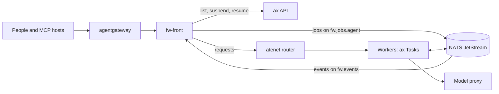

# A fleet

A fleet is a front for people and a set of workers. A worker is a bare `fw` in an AX Task. The front is `fw-workbench` outside the sandboxes. It reads the Tasks from the ax API and the runs from the egress stream of the workers. NATS carries the jobs in and the events out. This page tells how to deploy one, with `examples/agentgateway/fleet.yaml` and `examples/pools/fw.yaml` of the workbench as the worked examples. [The fleet](../concepts/fleet.md) explains the idea.

## The parts



| Part | What it is | In the examples |
|---|---|---|
| NATS | JetStream for the queues and the stream. The WebSocket listener is for workers, because the egress gateway of Substrate refuses a protocol whose server speaks first. | `fleet.yaml`: a StatefulSet with the ports 4222 and 8080 (WebSocket) in the namespace `fw-fleet` |
| The front | A Deployment of `fw-workbench` with no agents of its own. Two replicas can answer any request. | `fleet.yaml`, the Deployment `fw-front` with two replicas |
| The workers | ax Tasks that run the kernel image. A named member comes from `fw ax up`, a pooled one from `workbench.pools`. | `fleet.yaml` runs one worker `reviewer` as a plain Deployment. `pools/fw.yaml` keeps three Tasks of the profile `triage`. |
| The model proxy | A Service with a cluster name that an egress rule can name. It forwards to the model server and can add the key, so no sandbox holds it. | `pools/fw.yaml` names `model-proxy.models.svc.cluster.local` |
| agentgateway | Optional. One public URL that serves `/mcp`, `/ui`, and `/v1`. | `fleet.yaml`: the Gateway `fleet` for the host `fleet.example.com` |
| The collector | Optional. An OpenTelemetry collector that the front and the workers push to. See [Observability](observability.md). | `examples/observability` of the kernel |

## The front

The front reads its configuration once, at its start, from the file in `FW_CONFIG` and from the variables `FW_WORKBENCH_FLEET_*`, which win over the file. The block `workbench.fleet` names its sources. See [the workbench architecture, section 4.6](../design/workbench-architecture.md#46-configuration).

| Key | Variable | Meaning | Default |
|---|---|---|---|
| `workbench.fleet.atespaces` | `FW_WORKBENCH_FLEET_ATESPACES` | The atespaces whose Tasks are members, read from the ax API at `ax.server` | none |
| `workbench.fleet.egress` | `FW_WORKBENCH_FLEET_EGRESS` | The subject prefix of the egress stream, `bus.egress` of each worker | none |
| `workbench.fleet.intake` | `FW_WORKBENCH_FLEET_INTAKE` | The subject prefix of the intake queues. The queue of the profile `<agent>` is `<intake>.<agent>`. | none |
| `workbench.fleet.name` | `FW_WORKBENCH_FLEET_NAME` | The name of this process in the view | `<atespace>/<task>` under ax, else `<host>:<port>` |
| `workbench.fleet.interval` | `FW_WORKBENCH_FLEET_INTERVAL` | The time between two reads of the Task list and the queues | `30s` |
| `workbench.fleet.expire` | `FW_WORKBENCH_FLEET_EXPIRE` | The age after which the view forgets a finished run | `168h` |
| `workbench.fleet.suspendAfter` | `FW_WORKBENCH_FLEET_SUSPEND_AFTER` | How long a Task stays idle before the front suspends it, or `off` | `10m` with atespaces |
| `workbench.fleet.wakeOnQueue` | `FW_WORKBENCH_FLEET_WAKE_ON_QUEUE` | Whether jobs that wait in a queue wake the sleeping Tasks of the profile | on with atespaces and intake |
| `workbench.pools` | none | The pools of Tasks that the front keeps | none |
| `workbench.sources` | none | The event sources | none |

`atespaces` or `egress` turns the fleet on. The front also needs the bus, `bus.driver: nats` and `bus.url`. It needs the ax API, `ax.server` or `FW_AX_SERVER`, and the router, `ax.router`. A front of an ax fleet sets variables like these:

```yaml
env:
  - {name: FW_HOME, value: /data}
  - {name: FW_CONFIG, value: /etc/fw/fw.yaml}           # the ConfigMap with the pools and the sources
  - name: FW_API_TOKEN
    valueFrom: {secretKeyRef: {name: fw-fleet-token, key: FW_API_TOKEN}}
  - {name: FW_AUTH_MODE, value: "oidc,token"}
  - {name: FW_AUTH_OIDC_ISSUER, value: "https://idp.example.com"}
  - {name: FW_AUTH_OIDC_AUDIENCE, value: "https://fleet.example.com/mcp"}
  - {name: FW_AUTH_OIDC_NAME_CLAIM, value: email}
  - {name: FW_AUTH_OIDC_CLIENT_ID, value: "<client id>"}  # turns the browser sign-in on
  - name: FW_MCP_STATE_KEY
    valueFrom: {secretKeyRef: {name: fw-front, key: FW_MCP_STATE_KEY}}
  - name: FW_GRANT_KEY
    valueFrom: {secretKeyRef: {name: fw-front, key: FW_GRANT_KEY}}
  - {name: FW_WORKBENCH_GRANTS_DIR, value: /data/grants}  # a PersistentVolumeClaim
  - {name: FW_BUS_DRIVER, value: nats}
  - {name: FW_BUS_URL, value: "nats://nats.fw-fleet.svc.cluster.local:4222"}
  - {name: FW_WORKBENCH_FLEET_EGRESS, value: fw.events}
  - {name: FW_WORKBENCH_FLEET_INTAKE, value: fw.jobs}
  - {name: FW_WORKBENCH_FLEET_ATESPACES, value: default}
  - {name: FW_WORKBENCH_FLEET_INTERVAL, value: 10s}
  - {name: FW_WORKBENCH_FLEET_SUSPEND_AFTER, value: 60s}
  - {name: FW_AX_SERVER, value: "ax-server.ax-system.svc.cluster.local:8080"}
  - {name: OTEL_EXPORTER_OTLP_ENDPOINT, value: "http://opentelemetry-collector.otel-system.svc.cluster.local:4318"}
  - {name: FW_MCP_AUTH_AUDIENCE, value: "https://fleet.example.com/mcp"}
```

The two replicas share the cookie key and the grant key of one Secret, and the grants on one volume. A connection and a token request can therefore land on either. The front reads its configuration once, so a change of the ConfigMap needs a restart of every replica. A hash of the rendered configuration in an annotation of the pod template does that. Two replicas with two configurations fight over a pool. Two Services expose the front: `fw-front` for `/ui`, `/v1`, and `/.well-known`, and `fw-front-mcp` with the label `fw.dev/mcp: front` and the `appProtocol` `agentgateway.dev/mcp`.

At every interval the front lists the Tasks, reads the queues, and suspends a running Task that stayed idle for `suspendAfter`. Before a suspend it reads `GET /v1/status` of the Task once through the router. It also suspends a Task whose status says `blocked` after a storage failure. The next request restarts that Task from its ledger (see [The fleet](../concepts/fleet.md#idle-and-the-suspend-controller)). A job wakes the sleeping Tasks that serve its profile, and so do jobs that wait in a queue. See [sections 4.12](../design/workbench-architecture.md#412-the-suspend-controller) and [4.13](../design/workbench-architecture.md#413-queue-depth).

## A worker

A worker needs no key of the block `workbench`. Its `fw.yaml` names the bus, the model, the token broker, the spawner, and its profile. This is the `fw.yaml` of a named member, cut to the keys that matter:

```yaml
auth:
  mode: oidc,token              # token alone, without an issuer
model: openai/<model>
effort: low
providers:
  openai:
    baseUrl: http://model-proxy.models.svc.cluster.local:8080/v1
    apiKeyEnv: OPENAI_API_KEY   # a placeholder, because the proxy holds the key
prices:
  openai/<model>: {input: 0, output: 0}
bus:
  driver: nats
  url: ws://nats.fw-fleet.svc.cluster.local:8080   # WebSocket, because the egress gateway carries HTTP
  egress: fw.events             # the front reads the lifecycle events here
  intake: fw.jobs.reviewer      # the front puts the jobs of this profile here
  egressTypes: [fw.run.queued, fw.run.started, fw.run.resumed, fw.run.suspended, fw.run.finished, fw.approval.requested, fw.approval.decided, fw.run.annotated, fw.turn.started, fw.message.received, fw.run.child, fw.outcome.evaluated]
  options:
    concurrency: 1              # a Task runs one run at a time
tools:
  builtin: [bash, files, memory, clock, ask_user, spawn_task, await_task, env]
  files:
    root: /workspace
  mcp:
    - name: github
      endpoint: http://github-mcp.fw-fleet.svc.cluster.local:8082
      auth:
        bearer: GITHUB_MCP_TOKEN      # a placeholder that the egress gateway replaces
      trusted: true
    - name: tickets
      endpoint: http://tickets.fw-fleet.svc.cluster.local/mcp
      auth:
        oauth:
          grant: user                 # the token of the person, from the front
spawn:
  driver: ax                    # each child of spawn_task gets a Task of its own
budget:
  maxTurns: 12
  deadline: 15m
  maxToolCalls: 24
agents:
  reviewer:                     # the profile of this member, with its access block
    system: You review pull requests in the repository under /workspace.
    tools: [bash, files, "github.*"]
```

`bus.options.concurrency: 1` matters: the NATS intake takes four jobs at a time by default, so one Task holds four jobs while the others idle. The URL of the bus is `ws://`, because a Task reaches NATS over WebSocket. The token broker is `tokens.url`, which the Task sets with the variable `FW_TOKENS_URL`. See [the kernel architecture, sections 9.3](../design/kernel-architecture.md#93-intake) and [9.4](../design/kernel-architecture.md#94-egress).

The Task of a member sets these variables in `spec.env`:

- `FW_API_TOKEN`, the static token of the fleet.
- The model URLs and the model selector.
- `OPENAI_API_KEY` as a placeholder, because the proxy holds the key.
- `GITHUB_MCP_TOKEN` as a placeholder, because the egress gateway puts the token in its place.
- `FW_TOKENS_URL` with the Service of the front.
- `OTEL_EXPORTER_OTLP_ENDPOINT` with the collector.
- With an issuer, `FW_AUTH_OIDC_ISSUER`, `FW_AUTH_OIDC_AUDIENCE`, and `FW_AUTH_OIDC_NAME_CLAIM`.

[One Task on AX](one-task-on-ax.md) builds such a Task with `fw ax up`.

## The egress of a worker

A worker reaches nothing that its egress policy does not allow. With the patched AX, `spec.egress` of the Task carries the rules, and ax creates the policy before the first run ([Platform gaps and patches](../operations/platform-gaps.md)). These are the rules of the worker above:

| Rule | Allows |
|---|---|
| `http` `nats.fw-fleet.svc.cluster.local:8080` | The WebSocket listener of NATS |
| `http` `model-proxy.models.svc.cluster.local:8080` | The model behind its proxy |
| `http` `fw-front.fw-fleet.svc.cluster.local:8080` | The token broker of the front |
| `http` `opentelemetry-collector.otel-system.svc.cluster.local:4318` | The OTLP push |
| `http` `ax-server.ax-system.svc.cluster.local:8080` | The ax API, for `spawn_task` with `spawn.driver: ax` |
| `http` `atenet-router.ate-system.svc.cluster.local:80` | The router, through which a parent reaches its children |
| `http` `tickets.fw-fleet.svc.cluster.local:80` | An MCP server that acts for a person |
| `http` `github-mcp.fw-fleet.svc.cluster.local:8082` | The GitHub MCP server, with `replaceHeaders` that puts the token of a Secret in `Authorization` |
| `tlsPassthrough` `github.com`, `codeload.github.com` | A clone over TLS |

With an issuer, a rule for its Service lets a Task read the keys of the issuer. An environment adds `deb.debian.org:80` and TLS passthrough to `pypi.org`, `files.pythonhosted.org`, and `conda.anaconda.org`. `spec.egress` does not carry effects yet. A credential injection such as `replaceHeaders` therefore needs the policy from `kubectl-ate create egress-policy`, with the rules and their effects. An update of the live policy needs its `uid` and its `version`. A pool names its rules under `egress.rules`, and the front warns about each address of a worker that no rule allows.

## The shared token and the OIDC audiences

Every process of the fleet shares one static token. The front reads a worker with it, and a worker accepts it. When a worker asks the front for the tokens of a person, it presents the token too (the token broker, [section 11.9](../design/workbench-architecture.md#119-the-token-broker)). The token must have eight characters or more. `examples/agentgateway/README.md` creates it as the Secret `fw-fleet-token` with the key `FW_API_TOKEN`. Every Task reads it into `FW_API_TOKEN`, and the front copies it into every Task of a pool.

People sign in with OIDC. The audience of their tokens is the public `/mcp` URL. The same value goes in four places: the gateway policy, `resourceMetadata.resource`, `FW_AUTH_OIDC_AUDIENCE`, and `FW_MCP_AUTH_AUDIENCE`. One token then works on every process, and the front can forward it. `FW_AUTH_OIDC_AUDIENCE` of a Task takes more than one URL, so a Task behind two fronts accepts the tokens of either. See [Identity](../concepts/identity.md).

## Pools

A pool keeps a number of Tasks that run one profile. The front creates them with their Workspaces. It replaces a Task of an older configuration once it is idle, one at a time. It deletes the Tasks above the count, never a Task with an active run. See [the workbench architecture, section 14](../design/workbench-architecture.md#14-pools) and `examples/pools/fw.yaml` of the workbench.

| Key | Meaning | Default |
|---|---|---|
| `name` | The pool. Its Tasks are `<name>-<index>`, its Workspaces `<name>-<index>-ws`. | required |
| `replicas` | The number of Tasks. `0` deletes them once idle. | required |
| `image` | The worker image by digest | required |
| `fw` | The `fw.yaml` of each worker: the agents, the policy, the model, the providers, the tools | required |
| `egress` | `spec.egress` of each Task | required |
| `agent` | The profile whose queue the workers take | the only profile of `fw.agents` |
| `atespace` | The atespace of the Tasks, one of `workbench.fleet.atespaces` | the only atespace |
| `intake` | The intake queue | `<workbench.fleet.intake>.<agent>` |
| `generation` | A number that orders the configurations of the pool. Raise it with every change. | `0` |
| `revision` | Free text. A new value replaces every Task. | none |
| `env` | Variables, each with `name` and `value`, or `name` and `fromEnv`, a variable of the front | none |
| `resources`, `files` | The resources of the Task, and extra files of the Workspace | none |

The front writes `fw` to `.fw/fw.yaml` of the Workspace and adds `bus.intake`, `bus.egress`, and `bus.egressTypes`, which a pool cannot set. It adds the defaults `auth.mode: token`, the bus and the ax addresses of the front, and `bus.options.concurrency: 1` on NATS. It marks each Task with `FW_POOL`, `FW_POOL_SPEC` (the hash of the rendered specification), and `FW_BASH_HIDE`. When the generation is above 0, it adds `FW_POOL_GENERATION` and `FW_POOL_BASE`. It copies the static token under `auth.tokenEnv` of the worker. A pool cannot set `FW_*` or `AX_*` variables. Write a secret with `fromEnv`, never as `${NAME}`.

The front has no leader. Two replicas with two configurations replace each other's Tasks at every interval, so raise `generation` with every change. See [section 14.5](../design/workbench-architecture.md#145-no-leader).

The front owns the profiles of its pools. `agent_put`, `agent_delete`, and the builder write to the overlay of a pool. Always allow on an approval adds an allow rule to it. On NATS the overlay lives in the key-value bucket `<stream>_POOL_<pool>`, `FW_POOL_<pool>` by default, with the entries `profile.<name>` and `allow.<rule>`. A change of the overlay changes the hash, and the pool rolls. See [section 14.9](../design/workbench-architecture.md#149-profiles-and-rules-of-a-pool).

Review a change before the front acts:

```sh
fw-workbench pools render -config fw.yaml
```

It prints the Workspaces and the Tasks with the overlay merged and a placeholder for every secret. Do not apply the output.

`examples/pools/fw.yaml` keeps three workers of the profile `triage` on the queue `fw.jobs.triage`. Its policy allows every tool and asks before `tickets.update_ticket`, the one tool that writes to the ticket system. The file also offers a template `general`. From it, a person creates a runtime pool while the front runs, with the MCP tool `pool_put` or with `agent_put` and `workers`.

## Event sources

A source starts runs from an outside system. A webhook source takes `POST /v1/sources/{name}` outside the authentication of the native API, and a poll source reads a URL at an interval. Each run goes on the queue of the profile, and a key de-duplicates the events in a JetStream bucket. See [the workbench architecture, section 13](../design/workbench-architecture.md#13-event-sources) and `examples/sources/fw.yaml` of the workbench.

| Key | Meaning |
|---|---|
| `name`, `agent` | The source, and the profile whose queue takes the runs |
| `auth.mode` | `bearer`, `hmac`, or `none` for a webhook |
| `auth.secret` | The variable of the front that holds the bearer token or the HMAC key |
| `auth.header` | The header of the HMAC signature, `X-Signature-256` by default |
| `poll.url`, `poll.every`, `poll.timeout` | The endpoint of a poll source, the interval (`1m`), and the limit of one poll (`30s`) |
| `poll.secret`, `poll.header` | The variable of the credential, and the header that carries it as it is. Without a header it goes as a bearer token. |
| `items` | A dotted path to the array of events |
| `input`, `title`, `metadata`, `key` | Templates over one event. `key` is required. |
| `dedupFor` | How long a key blocks a second run, `168h` by default |
| `redrive` | `maxAttempts` and `cooldown` for an event whose job reached the dead letter |
| `runAs`, `runAsKind` | The principal of the runs, `source:<name>` and `workload` by default |

The secret of a webhook never goes in the file. `examples/sources/fw.yaml` reads the HMAC key of its ticket system from the variable `TICKETS_WEBHOOK_KEY` of the front, with the header `X-Signature-256`:

```yaml
workbench:
  sources:
    - name: tickets
      agent: triage
      auth: {mode: hmac, secret: TICKETS_WEBHOOK_KEY, header: X-Signature-256}
      input: |
        A ticket changed in the ticket system. Triage it.
        Ticket: {{.id}}
        Summary: {{.summary}}
      title: "Triage {{.id}}"
      key: "{{.id}}/{{.updated}}"
      redrive: {maxAttempts: 3, cooldown: 10m}
```

The second source of the file, `alerts`, polls an alert system every two minutes with `poll.secret: ALERTS_API_TOKEN`. It reads the array `data.alerts` and keys each run on the fingerprint and the start time of the alert, with `dedupFor: 24h`.

## agentgateway

`examples/agentgateway/README.md` of the workbench puts a fleet behind one public URL. Install agentgateway v1.6.0 and its CRDs with Helm, create the namespace and the Secrets, apply `fleet.yaml`, and point the DNS name at the Gateway. The rules that keep the dashboard and the login working:

- Give the MCP backend exactly one target, the front. With two, the gateway prefixes the tool names and rewrites `ui://` in the tool list.
- Keep `sessionRouting: Stateful`, so a session stays on the replica that holds it.
- Set the same audience in the four places above.
- Keep `backend.auth.passthrough`, so the front learns who the person is.
- Allow the resource `ui://fw/dashboard` in any `traffic.authorization` rule.
- Give every replica the same `FW_MCP_STATE_KEY`.
- Do not route `/metrics`.

The Gateway `fleet` of the example listens on port 80 for the host `fleet.example.com`. The HTTPRoute `fleet-mcp` sends `/mcp` and the two `/.well-known` documents of MCP to the `AgentgatewayBackend` `fw-mcp`. That backend selects the Service with the label `fw.dev/mcp: front`. The HTTPRoute `fleet-http` sends `/ui` and `/v1` to the Service `fw-front`. The `AgentgatewayPolicy` `fleet-mcp-auth` holds the login policy with the audience. A run with files needs a body limit above the default of the gateway, which another `AgentgatewayPolicy` on the route raises. See [section 3.8](../design/workbench-architecture.md#38-gateway).

## The order of steps

1. Build the images and push them to a registry that the cluster reaches. Substrate pulls an actor image by digest only, so record the digest of each push. See [Build and images](images.md).
2. If one public URL serves the fleet, install agentgateway v1.6.0 and its CRDs with Helm. `examples/agentgateway/README.md` has the commands.
3. Create the namespace `fw-fleet` and two Secrets: `fw-front` with the key that the replicas of the front share, and `fw-fleet-token` with the static token of the fleet.
4. Put the model server behind a proxy Service in the cluster. An egress rule names a DNS name, and Substrate accepts only local names in the `Host` header.
5. Replace the placeholders at the top of `fleet.yaml` and apply it. It creates NATS, the front, its two Services, and the routes of the gateway. Point the DNS name at the address of the Gateway.
6. Create the workers. A named member comes from `fw ax up` with a profile file ([One Task on AX](one-task-on-ax.md)). A pool comes from `workbench.pools` in the configuration of the front.
7. Add the server to Claude Code and call `fleet` ([Use a fleet from Claude Code](../getting-started/from-claude-code.md)). The members appear with the state `live` or `quiet`.

A later change of the images or of the configuration of the front rolls the Deployment and restarts the front. A named member does not change: run `fw ax down` and `fw ax up` again. When its `generation` rises, a pool rolls.

## Sources

- `featherweight-workbench/README.md` (section "The fleet")
- `featherweight-workbench/docs/ARCHITECTURE.md` (sections 3.8, 4, 13, and 14)
- `featherweight-workbench/fleet/config.go`
- `featherweight-workbench/fleet/types.go`
- `featherweight-workbench/fleet/suspend.go`
- `featherweight-workbench/pools/config.go`
- `featherweight-workbench/sources/config.go`
- `featherweight-workbench/cmd/fw-workbench/pools.go`
- `featherweight-workbench/examples/pools/fw.yaml`
- `featherweight-workbench/examples/sources/fw.yaml`
- `featherweight-workbench/examples/agentgateway/README.md`
- `featherweight-workbench/examples/agentgateway/fleet.yaml`
- `featherweight-kernel/examples/fw.yaml`
- `featherweight-kernel/cli/ax.go`
