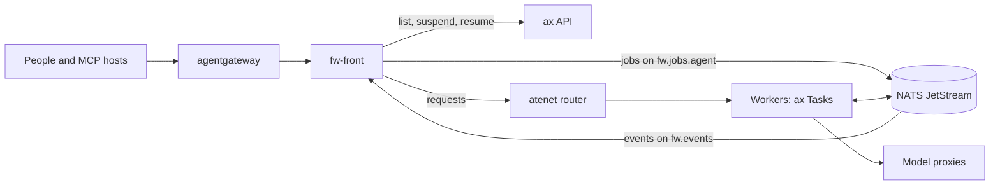

# A fleet

A fleet is a front for people and a set of workers. A worker is a bare `fw` in an AX Task. The front is `fw-workbench` outside the sandboxes, and it reads the Tasks from the ax API and the runs from the egress stream of the workers. NATS carries the jobs in and the events out. This page tells how to deploy one, with the manifests of the lab as the worked example. [The fleet](../concepts/fleet.md) explains the idea.

## The parts



| Part | What it is | In the lab |
|---|---|---|
| NATS | JetStream for the queues and the stream. The WebSocket listener is for workers, because the egress gateway of Substrate refuses a protocol whose server speaks first. | `e2e/fleet/base.yaml`: ports 4222 and 8080 (WebSocket) in the namespace `fw-fleet` |
| The front | A Deployment of `fw-workbench` with no agents of its own. Two replicas can answer any request. | `e2e/fleet/fw.yaml`, the Deployment `fw-front` |
| The workers | ax Tasks that run the lean kernel image. Named members come from `ax/run.sh`, pooled ones from `workbench.pools`. | `e2e/fleet/ax/run.sh` and `e2e/fleet/front-config.yaml` |
| The model proxies | nginx Services with a cluster name that an egress rule can name. `ax-model` forwards to the local model with the `Host` header `localhost:8080`. `ax-anthropic` adds the key of the Claude API from a Secret, so no sandbox holds it. | `e2e/fleet/ax/model-proxy.yaml`, `e2e/fleet/ax/model-anthropic.yaml` |
| agentgateway | Optional. One public URL that serves `/mcp`, `/ui`, and `/v1`. | `e2e/fleet/gateway.yaml` on port 8090 |
| The collector | Optional. An OpenTelemetry collector that the front and the workers push to. See [Observability](observability.md). | the stack of Substrate in `otel-system` |

## The front

The front reads its configuration once, at its start, from the file in `FW_CONFIG` and from the variables `FW_WORKBENCH_FLEET_*`, which win over the file. The block `workbench.fleet` names its sources. See [the workbench architecture, section 4.6](../design/workbench-architecture.md#46-configuration).

| Key | Variable | Meaning | Default |
|---|---|---|---|
| `workbench.fleet.atespaces` | `FW_WORKBENCH_FLEET_ATESPACES` | The atespaces whose Tasks are members, read from the ax API at `ax.server` | none |
| `workbench.fleet.egress` | `FW_WORKBENCH_FLEET_EGRESS` | The subject prefix of the egress stream, `bus.egress` of each worker | none |
| `workbench.fleet.intake` | `FW_WORKBENCH_FLEET_INTAKE` | The subject prefix of the intake queues. The queue of the profile `<agent>` is `<intake>.<agent>`. | none |
| `workbench.fleet.name` | `FW_WORKBENCH_FLEET_NAME` | The name of this process in the view | `<atespace>/<task>` under ax, else `<host>:<port>` |
| `workbench.fleet.interval` | `FW_WORKBENCH_FLEET_INTERVAL` | The time between two reads of the Task list and the queues | `30s` |
| `workbench.fleet.expire` | `FW_WORKBENCH_FLEET_EXPIRE` | The age after which the view forgets a finished run | `168h` |
| `workbench.fleet.suspendAfter` | `FW_WORKBENCH_FLEET_SUSPEND_AFTER` | How long a Task stays idle before the front suspends it, or `off` | `10m` with atespaces |
| `workbench.fleet.wakeOnQueue` | `FW_WORKBENCH_FLEET_WAKE_ON_QUEUE` | Whether jobs that wait in a queue wake the sleeping Tasks of the profile | on with atespaces and intake |
| `workbench.pools` | none | The pools of Tasks that the front keeps | none |
| `workbench.sources` | none | The event sources | none |

`atespaces` or `egress` turns the fleet on. The front also needs the bus (`bus.driver: nats`, `bus.url`) and the ax API (`ax.server`, `FW_AX_SERVER`) with the router (`ax.router`). The lab Deployment sets these variables:

```yaml
env:
  - {name: FW_HOME, value: /data}
  - {name: FW_CONFIG, value: /etc/fw/fw.yaml}           # the ConfigMap fw-front-config
  - name: FW_API_TOKEN
    valueFrom: {secretKeyRef: {name: fw-api-token, key: token}}
  - {name: FW_AUTH_MODE, value: "oidc,token"}
  - {name: FW_AUTH_OIDC_ISSUER, value: "http://issuer.fw-fleet.svc.cluster.local"}
  - {name: FW_AUTH_OIDC_AUDIENCE, value: "<public URL>/mcp"}
  - {name: FW_AUTH_OIDC_INSECURE, value: "true"}        # an http issuer, for the lab only
  - {name: FW_AUTH_OIDC_NAME_CLAIM, value: email}
  - {name: FW_AUTH_OIDC_CLIENT_ID, value: fw-lab}        # turns the browser sign-in on
  - name: FW_MCP_STATE_KEY
    valueFrom: {secretKeyRef: {name: fw-front-keys, key: FW_MCP_STATE_KEY}}
  - name: FW_GRANT_KEY
    valueFrom: {secretKeyRef: {name: fw-front-keys, key: FW_GRANT_KEY}}
  - {name: FW_WORKBENCH_GRANTS_DIR, value: /data/grants}  # a PersistentVolumeClaim
  - {name: FW_BUS_DRIVER, value: nats}
  - {name: FW_BUS_URL, value: "nats://nats.fw-fleet.svc.cluster.local:4222"}
  - {name: FW_WORKBENCH_FLEET_EGRESS, value: fw.events}
  - {name: FW_WORKBENCH_FLEET_INTAKE, value: fw.jobs}
  - {name: FW_WORKBENCH_FLEET_ATESPACES, value: default}
  - {name: FW_WORKBENCH_FLEET_INTERVAL, value: 10s}
  - {name: FW_WORKBENCH_FLEET_SUSPEND_AFTER, value: 60s}
  - {name: FW_AX_SERVER, value: "ax-server.ax-system.svc.cluster.local:8080"}
  - {name: OTEL_EXPORTER_OTLP_ENDPOINT, value: "http://opentelemetry-collector.otel-system.svc.cluster.local:4318"}
  - {name: FW_MCP_AUTH_AUDIENCE, value: "<public URL>/mcp"}
```

The two replicas share the cookie key and the grant key of the Secret `fw-front-keys`, and the grants on one volume, so a connection and a token request can land on either. The Deployment carries the annotation `fw.dev/front-config` with a hash of the rendered configuration, so a change of the ConfigMap restarts every replica. Two replicas with two configurations fight over a pool. Two Services expose the front: `fw-front` for `/ui`, `/v1`, and `/.well-known`, and `fw-front-mcp` with the label `fw.dev/mcp: front` and the `appProtocol` `agentgateway.dev/mcp`.

At every interval the front lists the Tasks, reads the queues, and suspends a running Task that stayed idle for `suspendAfter`. Before a suspend it reads `GET /v1/status` of the Task once through the router. A job wakes the sleeping Tasks that serve its profile, and so do jobs that wait in a queue. See [sections 4.12](../design/workbench-architecture.md#412-the-suspend-controller) and [4.13](../design/workbench-architecture.md#413-queue-depth).

## A worker

A worker needs no key of the block `workbench`. Its `fw.yaml` names the bus, the model, the token broker, the spawner, and its profile. This is `e2e/fleet/ax/fw.yaml` of the lab, cut to the keys that matter. `run.sh` fills the variables before the file goes into the Workspace:

```yaml
auth:
  mode: ${AUTH}                 # token, or oidc,token when the issuer exists
model: ${FLEET_MODEL}
effort: ${FLEET_EFFORT}
providers:
  openai:
    baseUrl: ${FLEET_MODEL_URL}          # http://ax-model.fw-fleet.svc.cluster.local:8080/v1
    apiKeyEnv: OPENAI_API_KEY
  anthropic:
    baseUrl: ${FLEET_ANTHROPIC_URL}      # http://ax-anthropic.fw-fleet.svc.cluster.local:8080
    apiKeyEnv: ANTHROPIC_API_KEY
prices:
  openai/<local model>: {input: 0, output: 0}
  anthropic/claude-haiku-5-5: {input: 0.10, output: 0.50}
bus:
  driver: nats
  url: ${FLEET_NATS_URL}        # ws://nats.fw-fleet.svc.cluster.local:8080
  egress: fw.events             # the front reads the lifecycle events here
  intake: fw.jobs.${AGENT}      # the front puts the jobs of this profile here
  egressTypes: [fw.run.queued, fw.run.started, fw.run.resumed, fw.run.suspended, fw.run.finished, fw.approval.requested, fw.approval.decided, fw.run.annotated, fw.turn.started, fw.message.received, fw.run.child, fw.outcome.evaluated]
  options:
    concurrency: 1              # a Task runs one run at a time
tools:
  builtin: [bash, files, memory, clock, ask_user, spawn_task, await_task, propose_agent, env]
  files:
    root: /workspace
  mcp:
    - name: github
      endpoint: ${FLEET_GITHUB_MCP_URL}
      auth:
        bearer: GITHUB_MCP_TOKEN      # a placeholder that the egress gateway replaces
      trusted: true
    - name: tickets
      endpoint: http://tickets.fw-fleet.svc.cluster.local/mcp
      auth:
        oauth:
          grant: user                 # the token of the person, from the front
spawn:
  driver: ax                    # each child of spawn_task gets a Task of its own
budget:
  maxTurns: 12
  deadline: 15m
  maxToolCalls: 24
${PROFILE}                      # the agents and the access block of ax/profiles/<task>.yaml
```

`bus.options.concurrency: 1` matters: the NATS intake takes four jobs at a time by default, so one Task holds four jobs while the others idle. The URL of the bus is `ws://`, because a Task reaches NATS over WebSocket. The token broker is `tokens.url`, which the Task sets with the variable `FW_TOKENS_URL`. See [the kernel architecture, sections 9.3](../design/kernel-architecture.md#93-intake) and [9.4](../design/kernel-architecture.md#94-egress).

The Task of a member, `e2e/fleet/ax/task.yaml`, sets these variables: `FW_API_TOKEN`, the model URLs and selector, `OPENAI_API_KEY` and `ANTHROPIC_API_KEY` as placeholders because the proxies hold the keys, `GITHUB_MCP_TOKEN` as a placeholder because the egress gateway puts the token in its place, `FW_TOKENS_URL` with the Service of the front, and `OTEL_EXPORTER_OTLP_ENDPOINT` with the collector. In the OIDC phase it adds `FW_AUTH_OIDC_ISSUER`, `FW_AUTH_OIDC_AUDIENCE`, `FW_AUTH_OIDC_INSECURE`, and `FW_AUTH_OIDC_NAME_CLAIM`. A migrator adds `FW_TOOLS_USER=none`, because its check applies a role to the Task itself.

## The egress of a worker

A worker reaches nothing that its egress policy does not allow. `e2e/fleet/ax/egress.json` of the lab is the policy of a member, and `run.sh` writes the same rules without their effects into `spec.egress` of the Task.

| Rule | Allows |
|---|---|
| `http` `nats.fw-fleet.svc.cluster.local:8080` | The WebSocket listener of NATS |
| `http` `ax-model.fw-fleet.svc.cluster.local:8080` | The local model behind its proxy |
| `http` `ax-anthropic.fw-fleet.svc.cluster.local:8080` | The Claude API behind its proxy |
| `http` `fw-front.fw-fleet.svc.cluster.local:8080` | The token broker of the front |
| `http` `opentelemetry-collector.otel-system.svc.cluster.local:4318` | The OTLP push |
| `http` `ax-server.ax-system.svc.cluster.local:8080` | The ax API, for `spawn_task` with `spawn.driver: ax` |
| `http` `atenet-router.ate-system.svc.cluster.local:80` | The router, through which a parent reaches its children |
| `http` `tickets.fw-fleet.svc.cluster.local:80` | The ticket system, a service that acts for a person |
| `http` `github-mcp.fw-fleet.svc.cluster.local:8082` | The GitHub MCP server, with `replaceHeaders` that puts the token of the Secret `fw-fleet/github` in `Authorization` |
| `tlsPassthrough` `github.com`, `codeload.github.com` | A clone over TLS |

In the OIDC phase a rule for `issuer.fw-fleet.svc.cluster.local:80` lets a Task read the keys of the issuer. A migrator adds `deb.debian.org:80` and TLS passthrough to `pypi.org`, `files.pythonhosted.org`, and `conda.anaconda.org` for its environment. `spec.egress` does not carry effects yet, so `e2e/fleet/ax/egress-apply.sh <actor> <atespace> <rules.json>` creates the policy with `kubectl-ate create egress-policy`, or updates it with the `uid` and the `version` of the live one. A pool names its rules under `egress.rules`, and the front warns about each address of a worker that no rule allows.

## The shared token and the OIDC audiences

Every process of the fleet shares one static token. The front reads a worker with it, a worker accepts it, and a worker presents it to the front when it asks for the tokens of a person (the token broker, [section 11.9](../design/workbench-architecture.md#119-the-token-broker)). The token must have eight characters or more. In the lab, `deploy.sh` makes the Secret `fw-fleet/fw-api-token` with the key `token`, keeps a copy in `e2e/results/.fleet-token` readable by you alone, and names the Secret in the ConfigMap `ready` under `apiTokenSecret`. `run.sh` reads it into `FW_API_TOKEN` of every Task, and the front copies it into every Task of a pool.

People sign in with OIDC. The audience of their tokens is the public `/mcp` URL, and the same value goes in four places, so one token works on every process and the front can forward it: the gateway policy, `resourceMetadata.resource`, `FW_AUTH_OIDC_AUDIENCE`, and `FW_MCP_AUTH_AUDIENCE`. The lab runs two fronts in its second phase, one per gateway, so `run.sh` gives each Task `FW_AUTH_OIDC_AUDIENCE` with both `/mcp` URLs, and the Tasks accept the tokens of either front. See [Identity](../concepts/identity.md).

## Pools

A pool keeps a number of Tasks that run one profile. The front creates them with their Workspaces, replaces a Task of an older configuration once it is idle, one at a time, and deletes the Tasks above the count, never a Task with an active run. See [the workbench architecture, section 14](../design/workbench-architecture.md#14-pools) and `examples/pools/fw.yaml` of the workbench.

| Key | Meaning | Default |
|---|---|---|
| `name` | The pool. Its Tasks are `<name>-<index>`, its Workspaces `<name>-<index>-ws`. | required |
| `replicas` | The number of Tasks. `0` deletes them once idle. | required |
| `image` | The worker image by digest | required |
| `fw` | The `fw.yaml` of each worker: the agents, the policy, the model, the providers, the tools | required |
| `egress` | `spec.egress` of each Task | required |
| `agent` | The profile whose queue the workers take | the only profile of `fw.agents` |
| `atespace` | The atespace of the Tasks, one of `workbench.fleet.atespaces` | the only atespace |
| `intake` | The intake queue | `<workbench.fleet.intake>.<agent>` |
| `generation` | A number that orders the configurations of the pool. Raise it with every change. | `0` |
| `revision` | Free text. A new value replaces every Task. | none |
| `env` | Variables, each with `name` and `value`, or `name` and `fromEnv`, a variable of the front | none |
| `resources`, `files` | The resources of the Task, and extra files of the Workspace | none |

The front writes `fw` to `.fw/fw.yaml` of the Workspace and adds `bus.intake`, `bus.egress`, and `bus.egressTypes`, which a pool cannot set. It adds the defaults `auth.mode: token`, the bus and the ax addresses of the front, and `bus.options.concurrency: 1` on NATS. It marks each Task with `FW_POOL`, `FW_POOL_SPEC` (the hash of the rendered specification), `FW_POOL_GENERATION` and `FW_POOL_BASE` when the generation is above 0, and `FW_BASH_HIDE`, and it copies the static token under `auth.tokenEnv` of the worker. A pool cannot set `FW_*` or `AX_*` variables. Write a secret with `fromEnv`, never as `${NAME}`.

The front has no leader. Two replicas with two configurations replace each other's Tasks at every interval, so raise `generation` with every change. The lab does this with `e2e/fleet/pool-generations.py`, which `front-config.sh` runs unless `FLEET_POOL_GENERATIONS=off`. See [section 14.5](../design/workbench-architecture.md#145-no-leader).

The front owns the profiles of its pools. `agent_put`, `agent_delete`, and the builder write to the overlay of a pool, and Always allow on an approval adds an allow rule to it. On NATS the overlay lives in the key-value bucket `<stream>_POOL_<pool>`, `FW_POOL_<pool>` by default, with the entries `profile.<name>` and `allow.<rule>`. A change of the overlay changes the hash, and the pool rolls. See [section 14.9](../design/workbench-architecture.md#149-profiles-and-rules-of-a-pool).

Review a change before the front acts:

```sh
fw-workbench pools render -config fw.yaml
```

It prints the Workspaces and the Tasks with the overlay merged and a placeholder for every secret. Do not apply the output.

The lab keeps two pools in `e2e/fleet/front-config.yaml`: `lab-pool`, one worker of the profile `pooled` that asks before each call of `clock`, and `tickets`, the triage workers of the ticket soak on the queue `fw.jobs.triage`, with `bus.intakeRetries: 2` and `maxCostUSD: 0.05`.

## Event sources

A source starts runs from an outside system. A webhook source takes `POST /v1/sources/{name}` outside the authentication of the native API, and a poll source reads a URL at an interval. Each run goes on the queue of the profile, and a key de-duplicates the events in a JetStream bucket. See [the workbench architecture, section 13](../design/workbench-architecture.md#13-event-sources) and `examples/sources/fw.yaml` of the workbench.

| Key | Meaning |
|---|---|
| `name`, `agent` | The source, and the profile whose queue takes the runs |
| `auth.mode` | `bearer`, `hmac`, or `none` for a webhook |
| `auth.secret` | The variable of the front that holds the bearer token or the HMAC key |
| `auth.header` | The header of the HMAC signature, `X-Signature-256` by default |
| `poll.url`, `poll.every`, `poll.timeout` | The endpoint of a poll source, the interval (`1m`), and the limit of one poll (`30s`) |
| `poll.secret`, `poll.header` | The variable of the credential, and the header that carries it as it is. Without a header it goes as a bearer token. |
| `items` | A dotted path to the array of events |
| `input`, `title`, `metadata`, `key` | Templates over one event. `key` is required. |
| `dedupFor` | How long a key blocks a second run, `168h` by default |
| `redrive` | `maxAttempts` and `cooldown` for an event whose job reached the dead letter |
| `runAs`, `runAsKind` | The principal of the runs, `source:<name>` and `workload` by default |

The secret of a webhook never goes in the file. The lab keeps the bearer token of `lab-hook` in the Secret `fw-fleet/fw-lab-hook` and gives it to the front as `FW_LAB_HOOK_TOKEN`, and the HMAC key of the Gitea webhook in `tickets-hook` as `FW_TICKETS_HOOK_KEY` with the header `X-Gitea-Signature`:

```yaml
workbench:
  sources:
    - name: lab-hook
      agent: reviewer
      auth: {mode: bearer, secret: FW_LAB_HOOK_TOKEN}
      input: "Answer with the single word {{.word}} and nothing else."
      title: "Hook {{.id}}"
      key: "{{.id}}"
```

The poll form of the ticket source reads the open tickets of Gitea every 30 seconds with `poll.secret: GITEA_POLL_TOKEN` and `poll.header: Authorization`. `front-config.sh` chooses the form with `TICKETS_SOURCE=webhook` or `poll`.

## agentgateway

`examples/agentgateway/README.md` of the workbench puts a fleet behind one public URL. Install agentgateway v1.6.0 and its CRDs with Helm, create the namespace and the Secrets, apply `fleet.yaml`, and point the DNS name at the Gateway. The rules that keep the dashboard and the login working:

- Give the MCP backend exactly one target, the front. With two, the gateway prefixes the tool names and rewrites `ui://` in the tool list.
- Keep `sessionRouting: Stateful`, so a session stays on the replica that holds it.
- Set the same audience in the four places above.
- Keep `backend.auth.passthrough`, so the front learns who the person is.
- Allow the resource `ui://fw/dashboard` in any `traffic.authorization` rule.
- Give every replica the same `FW_MCP_STATE_KEY`.
- Do not route `/metrics`.

The lab Gateway `fleet` listens on port 8090. Its HTTPRoute sends `/mcp` to the `AgentgatewayBackend` `fw-mcp` and `/ui`, `/v1`, and `/.well-known` to the Service `fw-front`, and an `AgentgatewayPolicy` raises the body limit to 48 MiB for runs with files. See [section 3.8](../design/workbench-architecture.md#38-gateway).

## The order of steps in the lab

1. Build and push the images. Start the tunnel and run `e2e/fleet/redeploy.sh`. See [Build and images](images.md).
2. Choose the model. `e2e/fleet/model.sh` takes `FLEET_MODEL` and `FLEET_EFFORT` from the environment or `e2e/local.env`, and defaults to the local model of the ConfigMap `ready`. A paid model is never a default. For the Claude API, run `e2e/fleet/anthropic-key.sh` first, which puts the key in the Secret `fw-fleet/anthropic`, then set `FLEET_MODEL=anthropic/<model>`.
3. Run `e2e/fleet/deploy.sh`. It applies `base.yaml`, makes the Secrets `fw-api-token`, `fw-front-keys`, `fw-lab-hook`, `tickets-hook`, and `gitea-agent` when they do not exist, applies the model proxies, renders `front-config.yaml` with `front-config.sh` into the ConfigMap `fw-front-config`, applies `fw.yaml` with the images and the public URL, patches the annotation of the front, applies `gateway.yaml`, runs `observe.sh`, waits for NATS and the front, and writes the ConfigMap `ready` with `natsURL`, `natsWsURL`, `frontURL`, `publicURL`, the images, the model, `apiTokenSecret`, and `fleetSubject`. `FLEET_PUBLIC` names the public URL.
4. Run `e2e/fleet/redeploy.sh` once more on a new cluster, so `ready` carries `imageWorker`.
5. Run `e2e/fleet/ax/run.sh`. It renders the Workspace and the Task of each member from `task.yaml`, `fw.yaml`, and `profiles/<task>.yaml`, renders `egress.json`, deletes the old Task, applies the new one, applies the policy with `egress-apply.sh`, and waits until `/readyz` answers through the router. A Task that crashed at boot gets a resume, up to three times. The members are `fw-fleet-alpha`, `fw-fleet-migrator` with `FLEET_MIGRATORS` copies, and `fw-fleet-reviewer`. `FLEET_ONLY` runs one of them.
6. For the browser sign-in, run `e2e/fleet/deploy-oidc.sh`. It builds the issuer `oauthlab`, makes the Secret `fleet-issuer` from `e2e/results/.fleet-issuer.pem`, applies `oidc.yaml` with the second front `fw-front-oidc` and its Gateway on port 8091, and records `oidcPublicMCP` in `ready`. Then run `ax/run.sh` again, so the Tasks accept the tokens of that front.
7. Check the result with `e2e/fleet/verify.py`, `verify-workbench.py`, `verify-oidc.py`, `ax/verify.sh`, and `features.py`, each with `python3 -I`, and `check-export.sh` for the telemetry. See [Testing](../operations/testing.md).

A later change of the images or of the configuration of the front goes through `redeploy.sh` again, which rolls the Deployments and restarts the front. A change of a member goes through `ax/run.sh`, which replaces its Task.

## Sources

- `featherweight-workbench/README.md` (section "The fleet")
- `featherweight-workbench/docs/ARCHITECTURE.md` (sections 4, 13, and 14)
- `featherweight-workbench/fleet/config.go`
- `featherweight-workbench/fleet/types.go`
- `featherweight-workbench/pools/config.go`
- `featherweight-workbench/sources/config.go`
- `featherweight-workbench/cmd/fw-workbench/pools.go`
- `featherweight-workbench/examples/pools/fw.yaml`
- `featherweight-workbench/examples/sources/fw.yaml`
- `featherweight-workbench/examples/agentgateway/README.md`
- `featherweight-workbench/examples/agentgateway/fleet.yaml`
- `featherweight-kernel/examples/fw.yaml`
- `featherweight-lab/e2e/README.md`
- `featherweight-lab/e2e/fleet/deploy.sh`
- `featherweight-lab/e2e/fleet/deploy-oidc.sh`
- `featherweight-lab/e2e/fleet/redeploy.sh`
- `featherweight-lab/e2e/fleet/front-config.yaml`
- `featherweight-lab/e2e/fleet/front-config.sh`
- `featherweight-lab/e2e/fleet/model.sh`
- `featherweight-lab/e2e/fleet/base.yaml`
- `featherweight-lab/e2e/fleet/fw.yaml`
- `featherweight-lab/e2e/fleet/gateway.yaml`
- `featherweight-lab/e2e/fleet/oidc.yaml`
- `featherweight-lab/e2e/fleet/ax/run.sh`
- `featherweight-lab/e2e/fleet/ax/task.yaml`
- `featherweight-lab/e2e/fleet/ax/fw.yaml`
- `featherweight-lab/e2e/fleet/ax/egress.json`
- `featherweight-lab/e2e/fleet/ax/egress-apply.sh`
- `featherweight-lab/e2e/fleet/ax/model-proxy.yaml`
- `featherweight-lab/e2e/fleet/ax/model-anthropic.yaml`
- `featherweight-lab/e2e/fleet/ax/profiles/fw-fleet-alpha.yaml`
- `featherweight-lab/e2e/fleet/ax/profiles/fw-fleet-migrator.yaml`
- `featherweight-lab/e2e/fleet/ax/profiles/fw-fleet-reviewer.yaml`
- `featherweight-lab/e2e/fleet/ax/profiles/fw-env-measure.yaml`
- `featherweight-lab/e2e/fleet/tickets/setup.sh`
