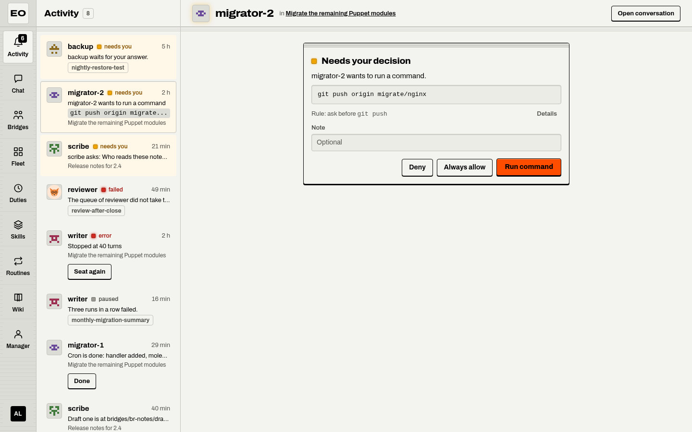
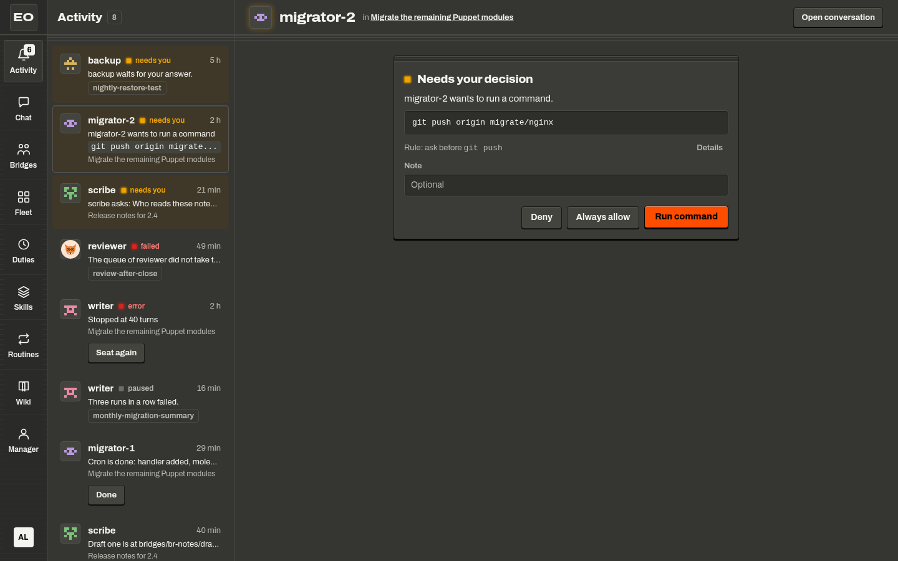

# Decisions and activity

Some steps of an agent need a person: a command that its rules hold, a question that only you can answer, or a service that it must use as you. Bossmode calls such a moment a decision. The agent waits, and the page puts the decision in front of you with one key for each answer.

{ .only-light }
{ .only-dark }

Bossmode draws three kinds of decision. An approval of a tool call offers Deny, Always allow, and the verb of the action, such as Run command. A question with a form offers Decline and Answer. A connect request offers Deny and a key that names the service, but only a finished connection in Connections lets the call go on. Each key sends `POST /v1/runs/{id}/approvals/{approval}`, and the kernel appends `fw.approval.decided` to the ledger of the run.

## What needs you

A decision shows as a card with an amber light that breathes, a hard black edge, and an orange key. Nothing else on the screen looks like it. While the card waits, the run, the piece of work that asked, waits too. Its worker, the sandbox that runs the agent, can sleep. [The run lifecycle](../concepts/run-lifecycle.md) explains why a wait costs nothing.

The same decision shows in up to three places, with the same keys in each:

- In Activity, the inbox of everything that needs you.
- In the channel of its bridge, for the run of a seat.
- In the conversation with the agent, in the Fleet, Chat, or Manager place.

Decide in one place, and the card turns quiet everywhere. A quiet card has a line edge and no keys, and it says who decided, such as "You allowed this". If the rules let another person decide and not you, the card says "Waits for a decision". A line names who decides, such as "An operator of migrator decides it". The card shows no key, because the page never offers a key that the server refuses.

## The Activity inbox

Activity lists what needs you across every bridge and duty. The count on its place in the app bar counts the rows that need you. The rows come in the order of attention:

1. Decisions and questions, the oldest wait first.
2. Errors: a seat that failed or stopped, a failed run of one of your duties, and a duty that paused itself.
3. Seats at the limit of their budget, and new messages.

The main pane shows the row that you pick. In a window with two panes, it opens the row that needs you and waits longest. After you decide, the main pane moves to the next row that needs you. If none is left, the decided card stays, quiet.

The keyboard reaches every row. Move with ArrowUp and ArrowDown, or j and k, and open a row with Enter.

| Key | On a row of | What it does |
|---|---|---|
| a | A decision | Allows it, after five seconds |
| a | A question | Opens the answer |
| d | A decision or a question | Denies it after five seconds. On a question of a seat, it picks the choice that says no, such as Decline. |
| r | A message | Replies to it |
| s | A failed or stopped seat | Seat again: starts the seat anew with its task |
| c | A seat at its limit | Continue: gives the run more room |
| e | A message | Done: clears the message for you |
| u | A decision that waits to go out | Undo |

The keys a and d hold the decision for five seconds before it goes out. The notice says "Allowed." or "Denied." with Undo, and the card counts down the seconds. Undo says "Undone. Nothing went out." The keys of a card act at once, without the hold.

## The kinds of decision

### An approval of a tool call

The policy of an agent can say "ask" for a tool, a command, or a field of a call. The card then says what the agent wants in a sentence, such as "migrator-2 wants to run a command". Below it is the plan of the call in plain form.

For a command, the plan is the command. For a bridge, it is the title and the seats. For a page, it is the path and the first lines. For a hand-off, it is the task, and for any other call, its fields.

The rule line says why the card asks, such as "Rule: ask before git push". Details shows the name of the tool and the raw input. Note takes an optional line that goes with your decision.

| Key | What happens next |
|---|---|
| Deny | The page sends the decision `deny`. The call does not run. The model reads "denied by" you, with your note, as the result of its call, and goes on. |
| Always allow | The page sends `POST /v1/runs/{id}/approvals/{approval}/rule`, then allows the call. The server adds an allow rule for the tool to the workers of the agent. The next such call runs without a card. |
| The verb of the action | The page sends the decision `allow`, and the call runs. The key names the action: Run command, Open bridge, Write page, Hand off, the label of the tool, or Allow. |

If one rule for the tool can stand in for the question, the card shows Always allow. It never shows for an ask of a flag such as `destructive`, or for a rule with a pattern such as `bash: git push*`. Only an owner of the agent can use it. For anyone else, the page says "Always allow needs an owner of the agent. Allow once instead." A card that asks to add a package offers Deny and Allow only. [Skills, tools, and packages](skills.md) explains packages.

### A question

An agent asks you with its tool `ask_user`. The card says "Needs your answer" and "scribe asks:" with the question. The card draws the form from the schema of the question. It shows one key per choice for a single choice, a small form for flat fields, and a text box for a free answer.

| Key | What happens next |
|---|---|
| Decline | The page sends the decision `deny`. The call of `ask_user` fails, and the agent goes on without an answer. |
| Answer | The page sends the decision `allow` with your answer as `content`. The answer becomes the result of the call. |

A seat of a bridge can also ask you in its channel. Its card says "Needs your answer" with the words of the seat, a key per choice, and a field for your answer. Answer posts your reply to the seat, and the seat starts its next turn. No answer needed ends the question, and the seat does not wake. [Bridges and seats](bridges.md) covers the channel.

### A connect request

A tool can need to act as you at a service, such as an issue tracker. If you have not connected that service, or your grant ended, the call waits for you. The card is the card of an approval. Its rule line holds the request, such as "Connect Tickets, so the agent can act as you there".

The orange key of this card names the service, such as Connect Tickets, but a click on it is not a grant. The server refuses that key with the reason `connect Tickets to continue; a decision can only skip it`. To connect, do these steps:

1. Open the account menu at the foot of the app bar.
2. Pick Connections. It opens `/ui#connections`.
3. Connect the service, and sign in at the service.

The server then tells every worker that you connected. Each call of yours that waits for that service goes on, and its card says that you allowed it, with the note `connected`. Deny skips the service instead: the call fails, and the agent reads that you chose not to connect.

## While a decision waits

A run that waits for your decision holds no process. With nothing to do, its sandbox goes to sleep and costs nothing. Your answer wakes the sandbox, and the run goes on from the step where it stopped. Press either key to see it.

A sleeping agent, `migrator-2`, asks to run `git push origin migrate/nginx`. Its run waits, and its sandbox is suspended. If you allow the command, the workbench sends the decision to the sandbox, and the sandbox wakes. The kernel reads its ledger, and the run goes on from the step where it stopped.

## Decisions while away

A duty, work that an agent starts on its own, can run while you sleep. One of its runs can need a decision. The setting `whileAway` of the duty says what happens then. This rule holds only for the runs of a duty. A decision of a bridge or a conversation always waits for a person.

| Case | Who decides while you are away |
|---|---|
| A question, or a connect request | You |
| A tool that the policy marks destructive | You |
| A duty that names nobody as the decider | You |
| A server with no manager | You |
| Any other approval | The manager, an agent that helps you run the fleet |

When the manager decides, the server asks it for a verdict and applies the verdict itself. The note of the decision says that the manager decided while the owner was away, with its reason. If nobody decides within the time of the duty, the server denies the call or cancels the run, as the duty says. You can always decide first, in Activity. The history of the duty records each decision and who made it. [Duties](duties.md) covers the setting.

## Where to reach me

The server can tell you about your duties while the page is closed. Open the account menu and pick Where to reach me. In this dialog, a place is one channel that reaches you, not a place of the app bar. You can keep up to 10 places.

- ntfy: the ntfy app on your phone, through a topic that it follows.
- Slack, Discord, or Teams: a channel, through its webhook.
- Webhook: any app that takes a JSON post, such as Home Assistant.
- Email: a plain mail to an address.
- Through an agent: an agent of the fleet delivers it with its own tools.
- A shared channel: a channel that an admin shares, such as the room of your team.

The page offers only the kinds that the server offers. Email, Through an agent, and shared channels need settings of the operator.

Each place has three switches. Questions sends two notices: a run of a duty needs you, or the server decided for you while you were away. Failures sends three notices: a run of a duty failed, a duty paused itself, or a duty reached a daily cap. A daily digest sends a summary of your duties once a day. Send a test sends a test notice to one place at once.

Quiet hours hold every place: from and to a time, in your time zone. A notice waits until the quiet hours end. If the server names its address in `workbench.notifications.link`, a notice links to the run in Activity.

!!! note

    Nothing goes out until you add a place. The server sends notices about duties only. A decision of a bridge or of a conversation shows in Activity and sends no notice.

## Where to go next

- [Duties Work that agents start on their own, and what they do while you are away](duties.md)
- [The manager The agent that can decide what you delegate to it](manager.md)

## Sources

- `featherweight-bossmode/docs/COPY.md`
- `featherweight-bossmode/src/ui/Decision.tsx`
- `featherweight-bossmode/src/ui/Activity.tsx`
- `featherweight-bossmode/src/ui/Notifications.tsx`
- `featherweight-bossmode/src/ui/ChannelDialog.tsx`
- `featherweight-bossmode/src/lib/decision.ts`
- `featherweight-bossmode/src/lib/words.ts`
- `featherweight-bossmode/src/lib/notifications.ts`
- `featherweight-bossmode/src/state/inbox.ts`
- `featherweight-bossmode/src/state/actions.ts`
- `featherweight-bossmode/src/api/routes.ts`
- `featherweight-kernel/fw/connect.go`
- `featherweight-kernel/fw/kernel.go`
- `featherweight-kernel/fw/turn.go`
- `featherweight-kernel/tokens/tokens.go`
- `featherweight-workbench/docs/ARCHITECTURE.md`, sections 6.2, 14.9, and 23
- `featherweight-workbench/surface/web/agents.go`
- `featherweight-workbench/connections/connections.go`
- `featherweight-workbench/inbox/inbox.go`
- `featherweight-workbench/notify/outbox.go`
- `featherweight-workbench/duties/away/away.go`
