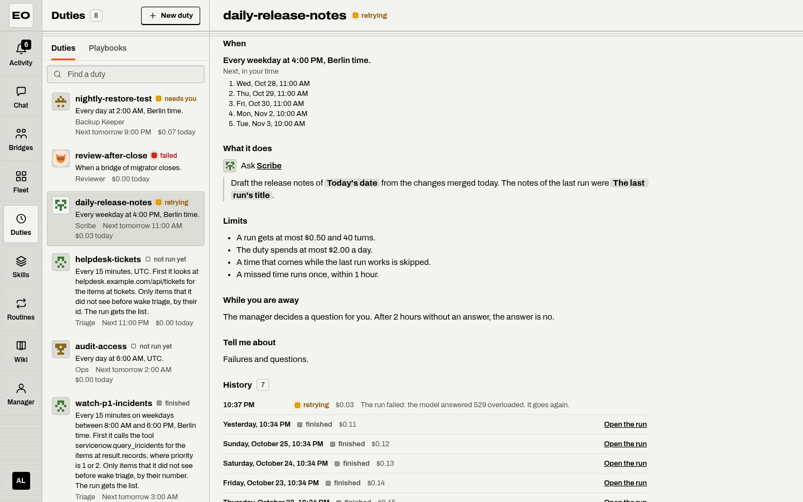
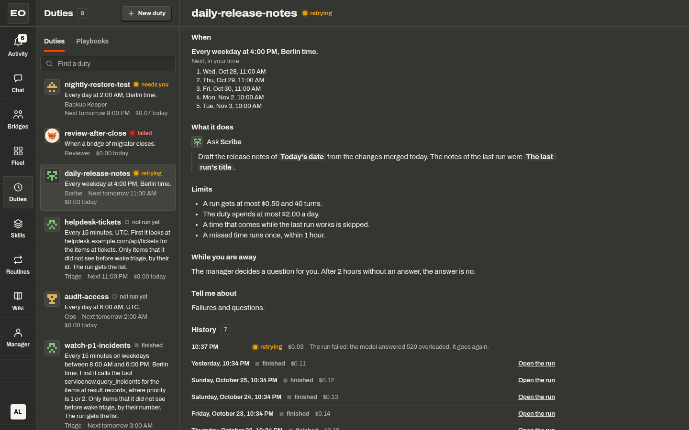

# Duties

A duty is work that an agent starts on its own. Examples are a report each morning and a look at a ticket queue every 15 minutes. You say the time in plain words, and the page reads it back to you. A duty can also look for work first. Then the agent wakes, and costs money, only for real work.

{ .only-light }
{ .only-dark }

The duty of the agent `triage` looks at a ticket queue every 15 minutes. It keeps the incidents of priority 1 or 2, and only an incident that it did not see before wakes the agent. The first check finds `INC1` and `INC3` and starts a run. The next check finds the same two, so the history says `slept`: "The check found 2 items, and none is new, so the agent did not wake." Three failed checks in a row pause the duty.

## Make a duty

Open the Duties place and press New duty. The editor asks seven things, in this order:

| Section | What you set |
|---|---|
| Who | The agent that does the work |
| When | A schedule, or an event of the fleet |
| Check first | Optional. What to look at before the agent wakes. |
| What | Ask the agent, Post in a bridge, Open a bridge from a playbook, or Ask the manager |
| Limits | The most a run can cost, the most turns, the most per day, and what to do with an overlap or a missed time |
| While you are away | Who decides for a run that waits while nobody watches |
| Tell me about | Who hears of failures and questions |

Press Save duty. The page asks Save this duty? and shows the readback of the server, the duty in plain words. Save duty in that dialog saves it.

You can also start from work that you did once. A chat, the manager, a conversation with an agent, and a bridge have Make this a duty in their menu More. It opens New duty with the agent and your first message. The budget stays empty, because a paid default is a silent cost.

A message can hold placeholders, which the page shows as words in brackets, such as `[Today's date]`, `[The last run]`, and `[What the check found]`. A chip under the message inserts one. The server fills them in before the run starts.

## Say when

A schedule is a sentence with choices. Five presets start it: Every morning, Every weekday, Every Monday, Every hour during work hours, and First of the month. Or write the time in Say it in your own words. The server reads the words with a fixed grammar and calls no model. It reads the schedule back in words, so you see how it understood them. These examples come from the tests of the workbench, for a person in New York:

| You say | The page reads back |
|---|---|
| `weekdays at 9:30am and 4pm` | Every weekday at 9:30 AM and 4:00 PM, New York time. |
| `every other Tuesday at 3pm` | Every other Tuesday at 3:00 PM, New York time, from October 27, 2026. |
| `on the first Monday of the month at 9` | On the first Monday of every month at 9:00 AM, New York time. |
| `every 2 hours between 8am and 6pm` | Every 2 hours from 8:00 AM to 6:00 PM, New York time. |
| `every weekday at 9 and 5` | Every weekday at 9:00 AM and 5:00 PM, New York time. |
| `twice a day` | Every day at 9:00 AM and 5:00 PM, New York time. |
| `every day at 7am in Europe/London` | Every day at 7:00 AM, London time. |

A bare hour that is not later than the hour before it is in the afternoon, so `at 9 and 5` means 9:00 and 17:00. When a part does not read, the answer names that part:

| You say | The answer |
|---|---|
| `every Tuesday after lunch` | Every Tuesday is clear. "after lunch" is not a time: pick one. |
| `every 5 minutes` | "every 5 minutes" is too often: the shortest step is 15 minutes. |
| `tomorrow at 10` | "tomorrow" is one day, and a duty repeats: say a repeat, such as every day at 10am, or start one run with Run now. |

Only between two dates sets a First day and a Last day. The page sends the time zone of your browser with the words, and the field Time zone shows the zone of the schedule.

A duty can also start on an event of the fleet. The events are these:

- When a bridge closes
- When a run of an agent fails
- When a question waits too long
- When a page changes
- When a routine is ready
- When a cap is reached

The page reads an event back in words too.

## Check first

A check looks for work before the model wakes, so a check costs no model tokens. At each time of the duty, the server reads an address or calls a tool of the agent. It finds the list of items in the answer. Filters keep the items that matter. By default, only an item whose key no earlier check saw wakes the agent. The run gets the items that woke it in `[What the check found]`, one item per line.

A check that finds no new item starts no run. The history shows the time as `slept`, with the reason. A check that fails shows `check failed`, and the model does not wake. After three failed checks in a row, the duty pauses itself and says why. A check that works ends the row, and so does Resume.

You set up a check in words. Write what must be true in the first field of Check first. An example is "there is a new P1 or P2 in the Platform Ops queue". Then press Write the check for me. The agent of the duty writes the check and tries it once. This can take up to two minutes. Set it up by hand opens the fields: the address or the tool, the filters as rows of a field, a test in words, and a value. Try the check runs it once, and saves nothing.

!!! note "What an operator sets"
    A check reaches only the hosts of `workbench.duties.checkHosts`. When that list is empty, a check reaches any public address, and never a private one. If `workbench.duties.secrets` lists a secret of the server, a check can send it. The check sends it only to the hosts of its entry.

??? note "Under the hood"
    The engine runs on each replica of the workbench, at least every 15 seconds. One replica claims each time, runs the check, and puts one run on the queue of the agent with the idempotency key `duty/<name>/<time>`. The check reads at most 1 MB in 30 seconds. A check with a tool runs as a check run of the kernel on a worker of the agent, with no model. The routes are `PUT /v1/duties/{name}`, with `?dryRun=true&test=true` for Try the check, and `POST /v1/duties/{name}/write-check`.

## What a duty does, and its limits

| What | A start | Limits |
|---|---|---|
| Ask the agent | One run of the agent with your message | The most a run can cost, which is required |
| Ask the manager | One run of the manager, which starts with "From the duty <name>." | The most a run can cost, which is required |
| Post in a bridge | Posts your message in an open bridge, to some members or to everyone | None. A post spends nothing of its own. The seats spend from their own budgets. |
| Open a bridge from a playbook | Opens a bridge from the playbook, titled with the duty and the date | The most turns of the bridge, which is required |

The most a run can cost has no default: its field says `Required, such as 0.50`. A duty that asks an agent without a budget does not save. These are the defaults. A time that comes while the last run works is skipped. A missed time runs once within 1 hour. A failed run goes again once. When three runs fail in a row, the duty pauses itself.

While you are away, the manager decides an approval of a run by default. The editor calls each such stop a question, but a question of `ask_user`, a connect request, and a destructive tool still wait for you. After 2 hours without a decision, the answer is no. The history of the duty says who decided, under the run. [Decisions while away](decisions.md#decisions-while-away) lists who decides each kind.

The page of a duty lists its history, newest first. Each time shows its light and word, such as `finished`, `slept`, `skipped`, `failed`, or `retrying` with a still amber light. Run now starts one run at once. It also runs a paused duty, for a test.

## Duties from the configuration, and calls from another app

Older setups list event sources in `fw.yaml`, under `workbench.sources`. At its start, the server copies each entry into the duties, once. From then on, the entry is an ordinary duty that you can edit. Its page says "First set up in the configuration of the server." A later change of the file changes no duty. If you delete such a duty, it does not come back after a restart.

An entry with `locked: true` becomes a locked duty. Its page says "This duty is locked by the setup of this server. The person who runs the server can change it." It keeps Run now, and no key that changes it.

Another app can also start a duty with a call. The app sends its event to `POST /v1/duties/{name}/call`, with a bearer token or an HMAC signature of the body. The run gets the event in `[What happened]`. A second call with the same key within a week, or with the same body within ten minutes, is a duplicate. The old address of a source, `POST /v1/sources/{name}`, answers in the same way for an imported duty. The fold For developers, under the readback, names the address and the header.

| Answer | When |
|---|---|
| 202 | The call started a run. |
| 200 | A duplicate, or a skip with its reason, such as a pause |
| 401 | The credential is missing or wrong. |
| 404 | No duty with a call has this name. |
| 413 | The body is larger than 1 MB. |

## Pause all duties

An admin sees the key Pause all duties at the top of the list. It asks Pause every duty?, with an optional reason. Then no duty starts until an admin presses Resume all duties. A run that works goes on. The times that passed during the pause do not run after it.

From Claude Code, the MCP tool `duties_pause_all` sets the same switch, and `PATCH /v1/duties` is its route. Each other action has a tool too: `duties_list`, `duty_get`, `duty_preview`, `duty_put`, `duty_pause`, `duty_run_now`, `duty_delete`, and `duty_write_check`. A client calls `duty_preview` first, shows you the readback, and saves with `duty_put` only after you agree.

## Where to go next

- [Bridges and seats The bridges that a duty posts in or opens](bridges.md)
- [Decisions and activity Where a failed duty or a question of a duty shows](decisions.md)

## Sources

- `featherweight-workbench/docs/ARCHITECTURE.md`, sections 13, 22, and 24
- `featherweight-workbench/duties/check.go`
- `featherweight-workbench/duties/check_test.go`
- `featherweight-workbench/duties/engine.go`
- `featherweight-workbench/duties/ops.go`
- `featherweight-workbench/duties/words.go`
- `featherweight-workbench/duties/record.go`
- `featherweight-workbench/duties/schedule/say_test.go`
- `featherweight-workbench/duties/schedule/readback_test.go`
- `featherweight-workbench/duties/events/events.go`
- `featherweight-workbench/cmd/fw-workbench/drivers.go`
- `featherweight-bossmode/docs/DESIGN.md`, section 11.10
- `featherweight-bossmode/docs/COPY.md`, section 9
- `featherweight-bossmode/src/lib/duties.ts`
- `featherweight-bossmode/src/ui/Duties.tsx`
- `featherweight-bossmode/src/ui/DutyEditor.tsx`
- `featherweight-bossmode/src/ui/DutyCheck.tsx`
