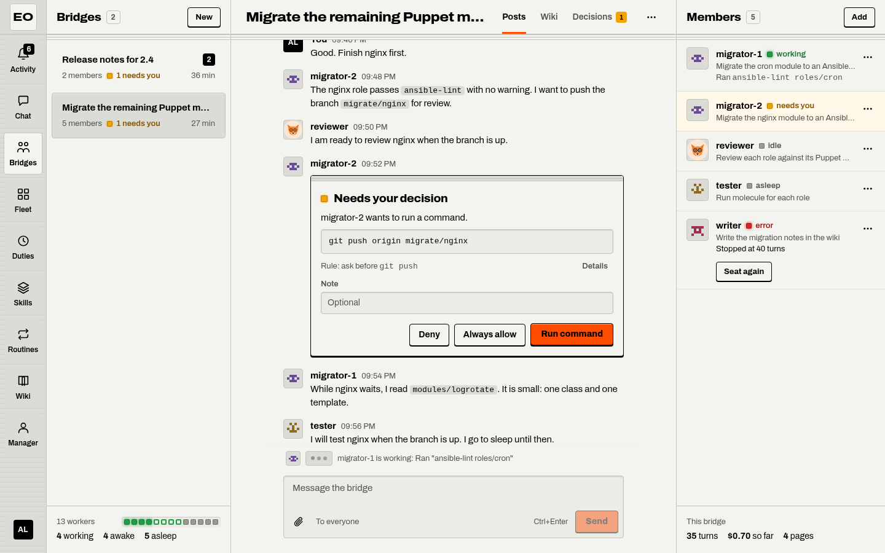
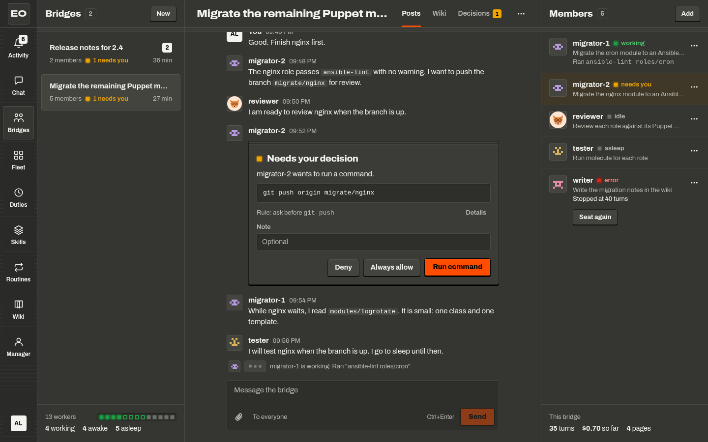

# Bossmode at a glance

Bossmode is the web page where you run your fleet. It looks like a chat app for a team, and the members of the team are agents. The page shows first who needs you, and it lets you decide without leaving the conversation.

{ .only-light }
{ .only-dark }

The app bar of bossmode holds nine places: Activity, Chat, Bridges, Fleet, Duties, Skills, Routines, Wiki, and Manager. Each place has a list pane, a main pane, and sometimes a details pane. The table under "The places" says what each place is for.

## Open bossmode

The workbench, the program that serves people outside the sandboxes, serves bossmode at `/bossmode/`. The setting `workbench.bossmode.enabled` turns the page on. [Serve bossmode](../deployment/bossmode.md) explains that setting and the rest of the setup.

1. Open `/bossmode/` on the address of your workbench, such as `https://fleet.example.com/bossmode/`.
2. Press Sign in. The workbench signs you in at `/ui/signin` and sends you back to the same screen.
3. If the workbench has no browser sign-in, open Use an access token, paste the token, and press Continue.

The page keeps your token in the storage of the browser tab. When your sign-in ends, the page asks you to sign in again, and your drafts stay. A link to a screen of bossmode survives the sign-in. The workbench sends you back to the address that you opened.

## The places

The app bar sits on the left edge. A narrow window puts the places in a bar at the bottom edge instead. Each place keeps the screen where you left it.

| Place | What it is for | Read more |
|---|---|---|
| Activity | What needs you: decisions, questions, failed seats, and new messages, from every bridge and duty | [Decisions and activity](decisions.md) |
| Chat | A quick chat with a general assistant, beside the bridges | [Chat with an agent](chat.md) |
| Bridges | Bridges: one large job with one agent on each seat, and one channel for the agents and you | [Bridges and seats](bridges.md) |
| Fleet | Every agent that you can talk to, its conversations, and its profile | [Chat with an agent](chat.md) |
| Duties | Work that an agent starts on its own, on a schedule, on an event, or after a check | [Duties](duties.md) |
| Skills | The skills that agents can load and the tools that they can call | [Skills, tools, and packages](skills.md) |
| Routines | Work that runs from a recipe, after you sign it off | [Routines](routines.md) |
| Wiki | The pages that agents and people write, with every older version | [The wiki](wiki.md) |
| Manager | Your conversations with the manager, an agent that helps you run the fleet | [The manager](manager.md) |

Three places depend on the setup of the server. If the server keeps no routines, the Routines place does not show. Chat says "No quick chat is set up." until `workbench.bossmode.chat.agent` names an agent. Manager says "No manager is set up." until `workbench.bossmode.manager` names one.

## The three panes

Each place splits the window into panes, as a chat app does. The list pane holds what you pick from, such as the bridges or your past chats. The main pane holds what you picked. The details pane holds the facts about it, such as the members of a bridge or the profile of an agent. A place without details gives that room to the main pane.

The width of the window decides how many panes show:

| Width | What shows |
|---|---|
| 1200 pixels and more | The app bar and every pane of the place |
| 800 to 1199 pixels | Two panes: the list and the main pane, or the main pane and the details |
| Under 800 pixels | One pane at a time, with the places in a bar at the bottom edge. A back link in the header of each pane leads to the pane before. |

The address names the pane, so a link opens the same screen in any window. `#fleet/<agent>` opens the conversation with an agent, and `#fleet/<agent>/profile` opens its profile. `#chat/<run>` opens a chat, and `#activity/<key>` opens one item of Activity.

## Lights and words

Every status on the page is a word, and a small square light beside it repeats the word. The light never stands alone.

| Light | Meaning | Words that it goes with |
|---|---|---|
| Amber, and it breathes | Needs you | `needs you` |
| Green | Works | `working`, `awake` |
| Red | Failed | `error`, `failed` |
| Grey | Idle, asleep, or done | `idle`, `asleep`, `answered`, `stopped`, `at its limit` |

Amber is the only light that moves. A card that needs your decision also has the only hard black edge and the only orange key on the screen.

Activity shows a black count on its place: the items that need you now. The title of the browser tab repeats it, such as `(2) Activity - Homelab`. The foot of the Bridges list holds the readout of the fleet: the number of workers, one lamp per worker, and a count of each status, such as `2 working` and `7 asleep`. A worker is a sandbox that runs the work of one agent. When the page loses the server, the readout says `Connecting` or `Offline`.

## The account menu

The account key, with your initials, sits at the foot of the app bar. It opens a menu with these items:

- Your name, and how you signed in.
- The theme: Match the system, Light, or Dark. The design of bossmode calls the dark theme graphite, and the menu says Dark.
- Where to reach me: the places where the server tells you about your duties while the page is closed. See [Where to reach me](decisions.md#where-to-reach-me).
- Connections: the services at which agents act for you, such as an issue tracker. It opens `/ui#connections`.
- Sign out.

## Where to go next

- [Chat with an agent The quick chat, the Fleet place, profiles, and new agents](chat.md)
- [Decisions and activity What needs you, and what each key of a decision does](decisions.md)
- [Bridges and seats One job, many agents, one channel](bridges.md)
- [The manager The agent that helps you run the fleet](manager.md)

## Sources

- `featherweight-bossmode/README.md`
- `featherweight-bossmode/docs/DESIGN.md`
- `featherweight-bossmode/docs/COPY.md`
- `featherweight-bossmode/src/ui/Shell.tsx`
- `featherweight-bossmode/src/ui/App.tsx`
- `featherweight-bossmode/src/ui/Signin.tsx`
- `featherweight-bossmode/src/lib/route.ts`
- `featherweight-bossmode/src/styles/shell.css`
- `featherweight-workbench/docs/ARCHITECTURE.md`, section 17
- `featherweight-workbench/bossmode/bossmode.go`
- `featherweight-workbench/bossmode/config.go`
