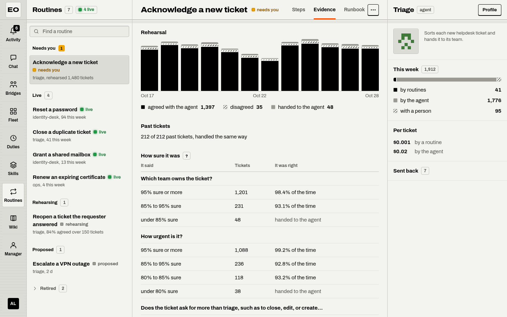
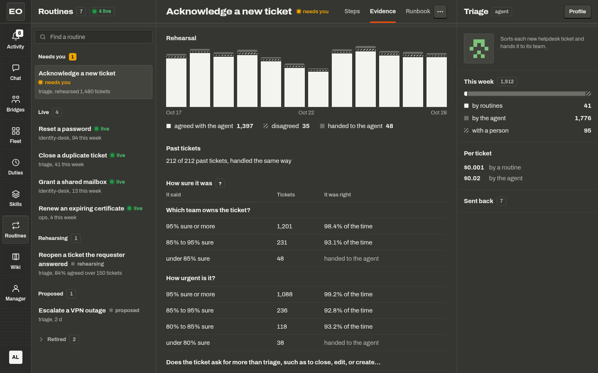

# Routines

A routine is work that an agent repeats, done in the same steps without the model. It rehearses beside the agent until the two agree, and it acts on its own only after a person signs it off. The Routines place shows each routine, the evidence for it, and its runbook.

A routine of the agent `triage` starts as Proposed. Rehearse moves it to Rehearsing, where it runs beside the agent without acting. After it chose to act on 200 tickets and agreed with the agent on 95 percent of them, it needs you. Sign off then makes it Live. Pause, Resume, and Retire move it on. A move that the table of standings forbids gets the answer 409 with the moves that it allows.

## What a routine is

A routine holds three parts. Questions are typed choices that a model answers about the input, such as "What kind of ticket is this?". Steps are tool calls in a fixed order, which use those answers. A check afterward reads the result and looks for the strings that it must hold and lack. The page counts each run of an agent as a ticket.

The kernel tries a live routine once per run, before the first model turn. Each question has a mark, such as 85% sure. If every answer passes its mark and is an answer that the routine expects, the routine runs its steps and its check. If those complete, the run finishes with the answer of the routine, and no model call happens.

If an answer is under its mark, a step fails, or the check fails, the agent takes the run. The agent then gets what the routine decided and did, so it does not start blind. Each step of a routine goes through the policy, the limits, and the budget of the run, as a call of the model does. A routine gets no extra rights.

A live routine still leaves a share of its runs to the agent, 5 percent by default, so the workbench keeps comparing the two.

??? note "Under the hood"
    The kernel holds a routine as `fw.Routine` in the `routines` list of a profile. The runner acts after `fw.run.started` and records `fw.routine.decided`, `fw.routine.applied`, and `fw.routine.compared`. It never acts on a replay, a branch, or a check run. The share of runs that the agent keeps is the key `canary` of a routine. See [the kernel design, section 22](../design/kernel-architecture.md#22-routines).

## Where a routine comes from

A routine comes from past runs, not from a person who types steps. The page has no editor for one, and an empty place says `No routine yet.`

1. Run `fw routine propose --agent <name>` where the ledgers of the agent are. It reads the runs that completed and that nobody sent back, and writes a routine.
2. Run `fw routine replay --routine <file>` over the same ledger. It checks the routine against the past runs, and reports how many it handles the same way.
3. Send the routine to the workbench with `PUT /v1/routines/{agent}/{name}`, or with the MCP tool `routine_put`. A new routine starts as Proposed.

Anyone with the operator role on the agent can propose a routine. The owner of the agent can also start it as Rehearsing. A worker image built with the tag `lean` does not carry `fw routine propose`, and the verb says so.

## The standings

A standing is the stage of a routine. The status of a routine on the page is its standing, or `needs you` for a rehearsing routine that is ready.

| Standing | Status on the page | What the runs of the agent see | Moves to |
|---|---|---|---|
| Proposed | `proposed`, grey | Nothing | Rehearsing, Retired |
| Rehearsing | `rehearsing`, grey, or `needs you`, amber | The routine answers beside the agent, without acting | Live, Paused, Retired |
| Live | `live`, green | When it applies, the routine acts in place of the model | Paused, Retired |
| Paused | `paused`, grey | Nothing | Rehearsing, Live |
| Retired | `retired`, grey and struck | Nothing | Nothing |

The page offers only the moves that the table allows. A proposed routine opens on a card with Retire and Rehearse. More, in the header of a routine, holds Pause and Retire for a rehearsing or a live routine, and Resume for a paused one. Resume moves the routine back to the standing that it had before the pause. A paused routine cannot retire, so resume it first.

Retire asks first: `A retired routine stays retired.` A move that the table forbids, sent to the route or the tool, answers 409 with the moves that the routine allows.

Only the owner of the agent moves a routine. Another person sees the card as `Needs a sign-off`, with no keys.

## Rehearsal and sign-off

While a routine rehearses, the workbench counts what happened on each ticket. Either the routine agreed with the agent, or it disagreed, or it handed the ticket to the agent because an answer was under its mark. Three things make a rehearsing routine ready, all counted over its current version:

- It chose to act on at least 200 tickets (`workbench.routines.readyAfter`).
- It agreed with the agent on at least 95 percent of them (`workbench.routines.readyAgreement`).
- No ticket where it agreed came back as sent back.

A ready routine moves to Needs you, at the top of the list. It opens on the card Needs your sign-off, with three figures: `agreed with the agent`, such as `97.6% of 1,432`, `handed to the agent`, and `sent back`. The card has a Note field and two keys.

- Sign off moves the routine to Live and records who signed it off and when. The card turns quiet and says Signed off, such as `By you, today.`
- Not yet sends nothing. The card turns into the quiet line Kept for later for this visit, and the row keeps `needs you`.

A sign-off holds for the version that you read. If the routine changed while you read it, the page says `This routine changed. Read it again.` A new body of a live or paused routine is a new version: it goes back to Rehearsing, loses its sign-off, and its evidence starts again. Only a person can sign a routine off. The manager can sign off only as its person, with the rights of that person, and its example policy asks that person first.

A duty can start on this moment. Pick `When a routine is ready` in the editor of a [duty](duties.md).

### The Evidence tab

{ .only-light }
{ .only-dark }

The Evidence tab says what happened, not why.

| Part | What it shows |
|---|---|
| Rehearsal | One bar per day: agreed with the agent, disagreed, and handed to the agent |
| Past tickets | The last replay, such as `212 of 212 past tickets, handled the same way` |
| How sure it was | For each question, the tickets at each level of sureness and how often the agent chose the same answer. The levels under the mark join in one row, handed to the agent. |
| Where it disagreed | The last tickets where the routine and the agent chose differently, with what happened afterward: `accepted`, `checked`, `sent back`, or `no answer yet` |
| Sent back | The tickets that came back, where the routine acted and where it agreed with the agent |
| Made from | The past tickets that the routine comes from, and who proposed it |

??? note "Under the hood"
    The workers publish the routine events on the egress stream, and the workbench counts them per version under `<agent>/<name>/evidence`. Sent back is a quality observation of `rejected`. See [the workbench design, section 21.4](../design/workbench-architecture.md#214-the-evidence).

## The runbook and the week of the agent

A sign-off writes the runbook, a page of the [wiki](wiki.md) at `agents/<agent>/routines/<name>.md`. The page says in words what the routine decides and which steps and tools it uses. It also names the check afterward, where the routine comes from, who signed it off, and its standing. Each later move writes the page again, so a paused or retired routine never reads as one that acts. The Runbook tab shows that page with Open in wiki. Before a sign-off, the tab shows the routine in the same words under `Not yet signed off`.

The details pane shows the agent of the routine and its week:

- This week: the runs of the agent, split into `by routines`, `by the agent`, and `with a person`.
- Per ticket: the average cost of a run `by a routine` and `by the agent`.
- Sent back: the runs of the week that came back.

## Turn routines on and off

Routines are on by default wherever the bus of the workbench keeps a store: `nats` or `mem`. On another bus, they are off.

| Key | Default |
|---|---|
| `workbench.routines.enabled` | On, where the bus is `nats` or `mem` |
| `workbench.routines.readyAfter` | `200` tickets |
| `workbench.routines.readyAgreement` | `0.95` |

Each key has a variable that wins over the file: `FW_WORKBENCH_ROUTINES_ENABLED`, `FW_WORKBENCH_ROUTINES_READY_AFTER`, and `FW_WORKBENCH_ROUTINES_READY_AGREEMENT`. The first variable takes `on` or `off`, and also `true`, `false`, `yes`, `no`, `1`, and `0`.

A workbench with routines off keeps no store, offers no routine tool, and gives the pools no routine. Bossmode then leaves the Routines place out of the app bar. An address of the place says `Routines are off.`, with the reason of the server behind the question mark.

A routine with questions also needs a model that answers them, on the workers of its pool. Name it in the block `deciders` of the configuration of the pool, and add the built-in tool `decide`. No such model exists by default. A routine without questions needs neither.

To stop one routine, pause or retire it. To stop every routine, set `workbench.routines.enabled: false`. The profiles then keep only the routines of their own configuration.

??? note "Under the hood"
    A rehearsing routine reaches the kernel with the standing `shadow`, and a live one with `live`. A move into or out of those standings replaces the Tasks of the pools that run the agent, once they are idle. A new body of such a routine does the same. See [the workbench design, section 21.7](../design/workbench-architecture.md#217-configuration).

## Where to go next

- [The wiki Where the runbook of each routine lives](wiki.md)
- [Duties Start work on a routine that is ready](duties.md)
- [Profiles, tools, and skills What an agent can call, and the policy that every step passes](../concepts/profiles-and-tools.md)

## Sources

- `featherweight-kernel/docs/ARCHITECTURE.md`
- `featherweight-kernel/docs/ROUTINES.md`
- `featherweight-kernel/cli/routine.go`
- `featherweight-kernel/cli/routine_propose.go`
- `featherweight-workbench/docs/ARCHITECTURE.md`
- `featherweight-workbench/routines/standing.go`
- `featherweight-workbench/routines/store.go`
- `featherweight-workbench/routines/evidence.go`
- `featherweight-workbench/routines/config.go`
- `featherweight-workbench/routines/routes.go`
- `featherweight-workbench/routines/tools.go`
- `featherweight-workbench/routines/ops.go`
- `featherweight-workbench/routines/runbook.go`
- `featherweight-workbench/bossmode/routes.go`
- `featherweight-workbench/duties/words.go`
- `featherweight-workbench/examples/bossmode/fw.yaml`
- `featherweight-bossmode/src/ui/Routines.tsx`
- `featherweight-bossmode/src/ui/RoutineEvidence.tsx`
- `featherweight-bossmode/src/ui/Shell.tsx`
- `featherweight-bossmode/src/lib/routines.ts`
- `featherweight-bossmode/docs/COPY.md`
- `featherweight-bossmode/docs/DESIGN.md`
