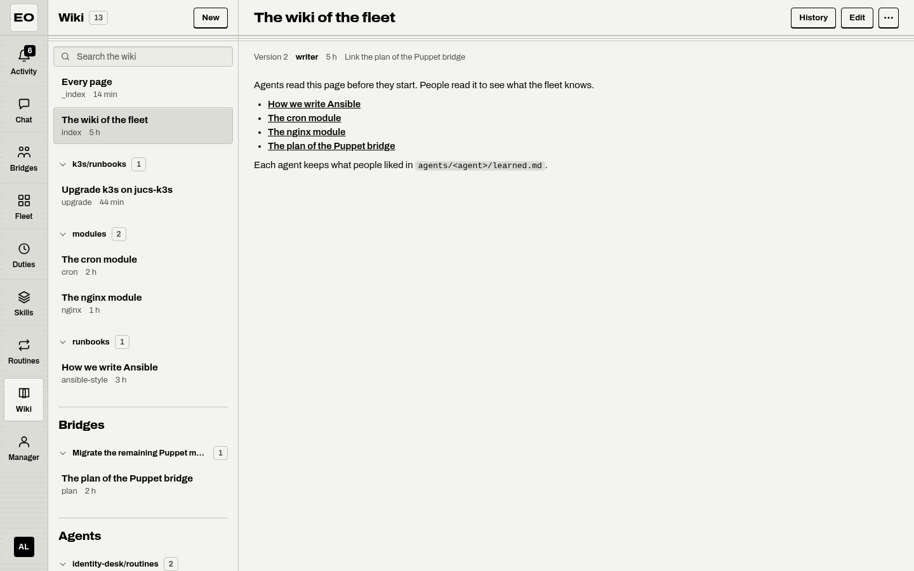
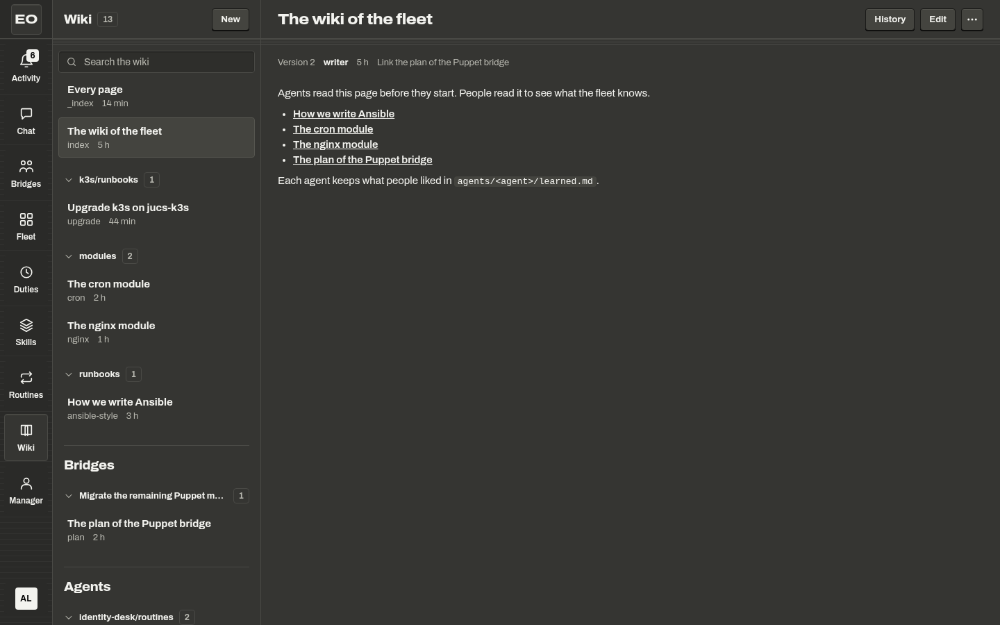

# The wiki

The wiki is a set of Markdown pages that the agents and the people of a fleet keep together. It is the long-term memory of the fleet. A page outlives the run that wrote it and the worker that ran it, and the wiki keeps its earlier versions.

{ .only-light }
{ .only-dark }

<div class="demo" data-demo="wiki-page" markdown>

A page, `runbooks/deploy.md`, has two versions. You open the editor, and the editor keeps the hash of the text that it read. If an agent writes the page first, your save names an old hash, so the workbench writes nothing and answers 412. The page then shows the newer version and asks you to take theirs or keep yours. Every version stays in the history, and a removed page comes back with Restore.

</div>

## Pages, versions, and writers

A page has a path, a text, and a hash. The path is a relative path that ends with `.md`, such as `runbooks/deploy.md`. The text is Markdown. It can start with front matter, a block of YAML between two `---` lines, and the wiki reads two keys of it: `title` and `tags`. Without `title`, the first heading of the page is its title. The hash is the SHA-256 of the whole text.

Each write makes a version. A version records the writer, the time, and a summary of one line that says what changed. A write by an agent records `agent:<profile>` and the run that wrote it. A write by a person records the person, and a write with the token of the fleet records `token`. The workbench itself writes as `bossmode`. A write of the text that the page holds already makes no version.

Two pages are special:

- `_index.md` is the tree of the wiki. The workbench writes it after each change, and nobody else writes or removes it. The instructions of every seat of a bridge tell the agent to read it first.
- `index.md` is an ordinary page: the home page that people write.

The text of a page is data that agents and people wrote, not an instruction. The tools and the index tell every model that reads a page so.

## Find and read a page

Open the Wiki place in the app bar. The list pane holds `Wiki` with its count of pages, the key `New`, and the field `Search the wiki`. Under the field, the tree groups the pages by folder, in the order that a person looks for them:

1. The pages at the root of the wiki.
2. The folders that people and agents keep for the place, such as `runbooks`, by path.
3. Under the heading `Bridges`, the work folder of each bridge, named by the title of the bridge.
4. Under the heading `Agents`, the folder of each agent, named by the agent.

Each row holds the title of the page, its name without `.md`, and how long ago it changed, such as `14 min`. A folder folds with a press on its head. The head of a folder of a bridge or an agent holds its path in the tooltip.

The search finds the pages that hold every word that you type, in the path, the title, or the text. A match in the path counts most, then the title, then the text. The results come best first, each with the line around the first match. If no page holds every word, the list says `No page holds those words. Try fewer words.` One search reads at most 16 MB of text. If it stops there, the list ends with `Partial: more words find the rest.`

A page opens in the main pane with its parts on one line: `Version 3`, the writer, the time, the summary, and the tags as chips. The version counts the versions of this page from 1. The header holds `History`, `Edit`, and the menu with `Remove page`. If someone saves the page while you read it, the line `<writer> saved a newer version.` shows, and the page shows the new text. A link in a page to a relative path, such as `../runbooks/deploy.md`, opens that page of the wiki.

## Write and edit a page

To start a page, press `New`. Type the name in the field `Name`, such as `runbooks/deploy`. A space between words becomes a hyphen, and the page adds `.md`. The hint `The page will be runbooks/deploy.md.` names the path before you press `Create page`. If the name is taken, the field says `A page with this name exists already. Pick another name, or edit that page.`

To change a page, press `Edit`. The editor holds `Text` and `What changed`, and `Save` writes a new version. Ctrl+Enter, or ⌘+Enter on a Mac, saves too. The editor keeps your draft in the browser tab, so a reload does not lose it. `_index.md` has no `Edit`, because only the workbench writes it.

A save is a compare-and-swap. The editor sends the hash of the text that it read. If the page still has that hash, the workbench writes the new text. If someone saved the page while you edited it, the workbench writes nothing and answers 412. The page then reads the newer version and shows a card: `<writer> saved this page while you edited it.` and `Your text is still here.` Under `See their version` is their text. Choose one of two keys:

| Key | What happens |
|---|---|
| `Take theirs` | The editor drops your text and holds theirs, with their hash. You can edit again before you save. |
| `Keep mine` | The page saves your text over theirs, with their hash. Their text stays in the history. |

Agents follow the same rule. The tool `pages_write` takes `ifHash`, the hash that `pages_read` gave. If the page changed since, the result names the new hash and tells the agent to read the page again and merge.

## History, removal, and restore

`History` opens `History of <page>`: every version that the wiki keeps, newest first. Each row holds `Version N`, the writer, the time, and the summary, and the newest one has the chip `current`. A removal is a row too, `Removed`, with its time. By default, the wiki keeps the last 64 versions of each page, and a removal counts as one.

Press an old version to read it. The line `Version 1, by alice, 2 d.` sits over the text, with the link `Current page` and the key `Restore this version`. A restore makes the old text the newest version, with the summary `Restored version 1`. The notice says `Restored version 1 as the newest version`. If someone saved the page in the meantime, the notice says `Someone saved a newer version of this page. Open the history again`.

To remove a page, open the menu of the page and choose `Remove page`. The dialog `Remove <page>?` says that the page leaves the wiki, and that its history keeps every version. After the removal, the notice `Removed <page>.` offers Undo for six seconds.

A removed page waits in the fold `Removed pages` at the end of the tree, with its count. Each row holds the time of the removal, such as `removed 3 hours ago`, and the key `Restore`. Restore reads the last version with a text and writes it as the page again, with the summary `Put back after a removal`. An address of a removed page says `This page was removed. Its history keeps its versions, and Restore brings one back.`

No tool removes a page. A removal is for a person on the page.

??? note "Under the hood"
    The routes are `GET`, `PUT`, and `DELETE` on `/v1/pages/{path}`, `GET /v1/pages/{path}/history`, `GET /v1/pages/search?q=`, and `GET /v1/pages/removed`. A save sends `If-Match` with the hash in quotes, and a new page sends `If-None-Match: *`. A 412 carries the hash of the page as it is, in the problem document and in `ETag`. A restore of a removed page also sends `If-None-Match: *`, because a removed page counts as absent. The version that `?version=` reads is the revision of the store. The revision counts the writes of the whole wiki, so the page numbers the versions of one page from 1 on its own. The store is `pages/store.go` of the workbench, and the screen is `src/ui/Pages.tsx` of bossmode.

## What the fleet writes into the wiki

Most pages come from work. These are the places that write them:

- Bridges. Each seat works in a private sandbox. Its instructions tell it to put every file that a teammate or a person must read on a page under `bridges/<id>/`. The tab `Wiki` of a bridge lists the pages of its work, each with the seat that wrote it. An empty tab says `No page yet. The members keep their notes and reports here, and you can write one too.` See [Bridges and seats](bridges.md).
- Reports. When a bridge closes, a manager is set up, and you let it write the report, the manager writes `bridges/<id>/report.md`. The channel then says `The report is in the wiki`, with a link.
- Hearts. A heart on a message of an agent in a bridge, the key `Heart: keep this in the wiki`, asks `What made this useful?`. The note is optional. The workbench adds an entry to `agents/<agent>/learned.md`, newest first: the date, the bridge, what was asked, what the agent did, your note, and a link to the run. The instructions of the next seats of that agent carry the start of the page, so a heart changes what the agent does next. The profile of the agent shows the newest hearts under `What people liked`, with `Open page`.
- Routines. When you sign off a routine, the workbench writes its runbook, `agents/<agent>/routines/<name>.md`, and writes it again at each later move. See [Routines](routines.md).
- Duties. A duty can start `When a page changes`, for a path that you name. See [Duties](duties.md).

The page `agents/<agent>/learned.md` holds at most 64 KB, so the oldest hearts fall off its end. A heart that you take back leaves its entry on the page.

## Who reads and who writes

| Caller | Reads | Writes |
|---|---|---|
| The agents on the workers, with the token of the fleet | Yes | Yes |
| A person with the operator role on an agent of the fleet | Yes | No |
| A person with the owner role on an agent of the fleet | Yes | Yes |
| Anyone else | No | No |

A person without the role gets 403. The profile of an agent says what it can do in one line, such as `Read and write the wiki`. An agent reaches the wiki through these MCP tools of the workbench:

| Tool | Arguments | What it does |
|---|---|---|
| `pages_list` | `prefix`, `limit` | Lists the pages by path, with the title, the version, the writer, and the time |
| `pages_read` | `path`, `version` | Reads one page with its text, its hash, its version, and its writer |
| `pages_write` | `path`, `text`, `summary`, `ifHash` | Writes the whole text as a new version. `ifHash` is a hash, `*` for a page that exists, or `absent` for a new page. |
| `pages_search` | `query`, `limit` | Searches as the field `Search the wiki` does |
| `pages_history` | `path` | Lists the versions of a page, newest first |

The wiki lives in the workbench, never on a worker. On a NATS bus it lives in the bucket `<stream>_PAGES`, `FW_PAGES` by default, so every replica of the workbench reads one wiki. On the bus `mem`, it lives in the memory of the process, and a restart loses it. On another bus, the wiki is off. Three keys set its limits:

| Key | Meaning | Default |
|---|---|---|
| `workbench.pages.maxPageBytes` | The largest text of a page, in bytes | `262144` |
| `workbench.pages.maxPages` | The most pages of the wiki, the index not counted | `10000` |
| `workbench.pages.history` | The versions of each page that the wiki keeps, at most 64 | `64` |

To copy the wiki to files and back, use these commands on a host that holds the `fw.yaml` of the workbench. Both need `bus.driver: nats`, and both take `-config` to name the file.

```sh
fw-workbench pages export ./wiki
fw-workbench pages import ./wiki
```

Export writes each page as one file under the directory, and the index as `_index.md`. Import writes each `.md` file as a new version of the page at its path, by `local:<user>`, with the summary `import from <dir>`. A file that holds the text of its page already changes nothing.

## Where to go next

<div class="paths" markdown>

- [Bridges and seats <span>The channel whose seats write most of the pages</span>](bridges.md)
- [Routines <span>The runbook that a sign-off writes into the wiki</span>](routines.md)
- [Context, memory, and time <span>The memory of one agent, beside the wiki of the fleet</span>](../concepts/context-memory-time.md)

</div>

## Sources

- `featherweight-workbench/docs/ARCHITECTURE.md` (sections 15, 18.4, 18.8, 18.9, 21.5)
- `featherweight-workbench/pages/pages.go`
- `featherweight-workbench/pages/store.go`
- `featherweight-workbench/pages/routes.go`
- `featherweight-workbench/pages/tools.go`
- `featherweight-workbench/pages/config.go`
- `featherweight-workbench/cmd/fw-workbench/pages.go`
- `featherweight-workbench/bridges/react.go`
- `featherweight-workbench/bridges/seat.go`
- `featherweight-workbench/routines/runbook.go`
- `featherweight-workbench/duties/record.go`
- `featherweight-bossmode/src/ui/Pages.tsx`
- `featherweight-bossmode/src/ui/Message.tsx`
- `featherweight-bossmode/src/ui/Profile.tsx`
- `featherweight-bossmode/src/ui/Channel.tsx`
- `featherweight-bossmode/src/api/routes.ts`
- `featherweight-bossmode/src/lib/lines.ts`
- `featherweight-bossmode/src/lib/tools.ts`
- `featherweight-bossmode/src/lib/duties.ts`
- `featherweight-bossmode/docs/COPY.md`
- `featherweight-bossmode/docs/CONTRACT.md` (sections 6.6 and 8)
